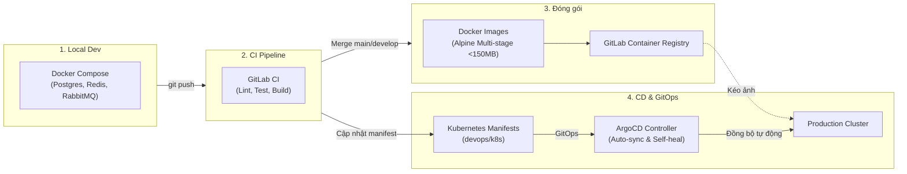

# 📘 BẢN HƯỚNG DẪN KIẾN TRÚC & VẬN HÀNH DEVOPS (PROJECT NEXUS)

> **Mục tiêu tài liệu:** Giúp tất cả thành viên trong nhóm (Frontend, Backend, QA, Lead) hiểu rõ toàn bộ bức tranh DevOps của dự án: hệ thống gồm những file nào, từng file làm nhiệm vụ gì, hoạt động ra sao và cách tự vận hành trên máy cá nhân.

---

## 🗺️ PHẦN 1: BỨC TRANH TỔNG THỂ (4 TRỤ CỘT DEVOPS)

Hệ thống DevOps của Project Nexus được thiết kế xoay quanh **4 trụ cột** khép kín từ lúc lập trình viên viết code cho đến khi chạy trên môi trường thực tế:



1. **Trụ cột 1: Local Development (Môi trường máy lập trình viên)**:
   - Dùng **Docker Compose** để khởi tạo toàn bộ hạ tầng phụ trợ (Database, Redis, Message Broker) chỉ bằng 1 câu lệnh, dev không cần cài đặt rườm rà vào máy tính cá nhân.
2. **Trụ cột 2: CI (Continuous Integration - Tích hợp liên tục)**:
   - Dùng **GitLab CI** để tự động kiểm tra code (format, commit message, unit test, build) mỗi khi có ai đó đẩy code lên hoặc tạo Merge Request.
3. **Trụ cột 3: Packaging (Đóng gói ứng dụng)**:
   - Dùng **Dockerfile Multi-stage** để đóng gói từng microservice thành các Docker image siêu nhẹ (dưới 150MB, dùng nền `node:20-alpine`) và đẩy lên GitLab Container Registry.
4. **Trụ cột 4: GitOps & Continuous Delivery (Triển khai tự động)**:
   - Dùng **Kubernetes (K8s)** để chạy và điều phối container trên máy chủ production.
   - Dùng **ArgoCD** theo cơ chế GitOps: ArgoCD liên tục theo dõi kho code Git; hễ có cấu hình mới trên Git, nó tự động cập nhật hệ thống thực tế mà con người **không cần SSH vào server**.

---

## 📂 PHẦN 2: DANH MỤC CÁC FILE DEVOPS & CÔNG DỤNG CHI TIẾT

Dưới đây là danh sách đầy đủ tất cả các file liên quan đến DevOps trong kho mã nguồn:

### 1. Nhóm cấu hình CI/CD (Tự động hóa kiểm thử & đẩy code)

| Tên file / Thư mục                  | Vị trí          | Công dụng chính                                                                                                                                                                                                           | Khi nào được chạy?                                                                    |
| :---------------------------------- | :-------------- | :------------------------------------------------------------------------------------------------------------------------------------------------------------------------------------------------------------------------ | :------------------------------------------------------------------------------------ |
| **`.gitlab-ci.yml`**                | Thư mục gốc `/` | **"Bộ não" điều khiển toàn bộ pipeline CI/CD**. Định nghĩa các giai đoạn: cài đặt thư viện (`install`), kiểm tra chuẩn code (`lint`), chạy test (`test`), build ứng dụng (`build`), và build ảnh Docker (`docker-build`). | Tự động chạy trên máy chủ GitLab Runner mỗi khi có `git push` hoặc tạo Merge Request. |
| **`.commitlintrc.json`**            | Thư mục gốc `/` | Định nghĩa quy tắc đặt tên commit chuẩn (Conventional Commits): bắt buộc phải có tiền tố `feat:`, `fix:`, `chore:`, `ci:` kèm scope (ví dụ `user`, `auction`, `web-customer`).                                            | Chạy ở máy dev (khi gõ `git commit`) và chạy lại trên CI để duyệt.                    |
| **`.husky/`**                       | Thư mục gốc `/` | Công cụ tự động móc vào Git hooks (`pre-commit`, `pre-push`, `commit-msg`) trên máy cá nhân.                                                                                                                              | Tự động chạy ngay trên máy của dev trước khi lệnh git hoàn tất.                       |
| **`scripts/verify-branch-name.js`** | `scripts/`      | Kiểm tra tên nhánh Git của dev: chặn tuyệt đối commit trực tiếp vào `main`/`master`, bắt buộc đặt tên nhánh theo 25 nhánh chuẩn của Sprint hoặc theo mẫu `feat/be-*`, `feat/fe-*`.                                        | Chạy trong hook `pre-push` và `pre-commit`.                                           |

---

### 2. Nhóm môi trường phát triển cục bộ (Local Runtime)

| Tên file                             | Vị trí          | Công dụng chính                                                                                                                                                                                                                                                | Ai/Lệnh nào sử dụng?                                                        |
| :----------------------------------- | :-------------- | :------------------------------------------------------------------------------------------------------------------------------------------------------------------------------------------------------------------------------------------------------------- | :-------------------------------------------------------------------------- |
| **`devops/docker-compose.dev.yml`**  | `devops/`       | **Chạy hạ tầng cơ sở dữ liệu cho Backend**: khởi chạy 6 container PostgreSQL độc lập (đảm bảo ranh giới Database-per-service theo kiến trúc DDD), 1 container Redis 7 (lưu cache & lock đấu giá), 1 container RabbitMQ 3 (truyền thông điệp giữa các service). | Chạy bằng lệnh: `pnpm docker:dev:up`                                        |
| **`devops/docker-compose.full.yml`** | `devops/`       | **Chạy toàn bộ hệ sinh thái (Full Stack)**: bao gồm cả 6 Database, Redis, RabbitMQ + 7 Backend Microservices + Web Frontend + Nginx.                                                                                                                           | Dùng khi muốn chạy thử cả hệ thống hoàn chỉnh không cần bật nhiều terminal. |
| **`devops/nginx/default.conf`**      | `devops/nginx/` | Cấu hình **Reverse Proxy của Nginx**: đóng vai trò cổng đón khách, định tuyến `/api/*` vào API Gateway (Port 4000) và các đường dẫn còn lại vào Web Frontend.                                                                                                  | Nginx container đọc file này khi khởi động.                                 |

---

### 3. Nhóm đóng gói Container (Docker Packaging)

| Tên file                           | Vị trí               | Công dụng chính                                                                                                                                                                                                                                                                               |
| :--------------------------------- | :------------------- | :-------------------------------------------------------------------------------------------------------------------------------------------------------------------------------------------------------------------------------------------------------------------------------------------- |
| **`Dockerfile` (Root)**            | Thư mục gốc `/`      | File đóng gói tham số hóa (`ARG SERVICE=api-gateway`). Sử dụng kỹ thuật **Multi-stage Build** (Giai đoạn 1: cài pnpm và build TypeScript; Giai đoạn 2: chỉ copy file chạy JS tinh gọn vào image `node:20-alpine`, chạy với quyền user thường `node` để bảo mật). Kích thước image dưới 150MB. |
| **`backend/<service>/Dockerfile`** | Từng thư mục service | Bản đóng gói chuyên biệt cho từng service (api-gateway, user-service, auction-service,...).                                                                                                                                                                                                   |
| **`.dockerignore`**                | Thư mục gốc `/`      | Liệt kê các thư mục cấm đưa vào image Docker (như `node_modules`, `.git`, file rác, `.env`) giúp image nhẹ và không bị lộ thông tin mật.                                                                                                                                                      |
| **`scripts/build-all-images.js`**  | `scripts/`           | Script Node.js tự động quét và build một lúc toàn bộ Docker images cho tất cả 7 microservices.                                                                                                                                                                                                |

---

### 4. Nhóm triển khai Kubernetes & GitOps (Production)

Tất cả nằm trong thư mục `devops/k8s/` và `devops/argocd/`:

| Tên file                                                                               | Công dụng chi tiết                                                                                                                                                                                                                                                                                                                                     |
| :------------------------------------------------------------------------------------- | :----------------------------------------------------------------------------------------------------------------------------------------------------------------------------------------------------------------------------------------------------------------------------------------------------------------------------------------------------- |
| **`namespace.yaml`**                                                                   | Tạo phân vùng độc lập tên là `nexus` trên cụm Kubernetes để không ảnh hưởng đến ứng dụng khác.                                                                                                                                                                                                                                                         |
| **`configmap.yaml`**                                                                   | Lưu các biến môi trường không nhạy cảm (như URL kết nối nội bộ k8s: `http://user-service:4001`, cấu hình port,...).                                                                                                                                                                                                                                    |
| **`secret.yaml`**                                                                      | Lưu các thông tin nhạy cảm đã mã hóa base64: Chuỗi kết nối Database, mật khẩu Postgres, JWT secret key, thông tin đăng nhập GitLab Registry.                                                                                                                                                                                                           |
| **`<service-name>.yaml`**<br>_(Ví dụ: `api-gateway.yaml`, `auction-service.yaml`,...)_ | Định nghĩa 2 thành phần K8s cốt lõi cho mỗi microservice:<br>1. **Deployment:** Khai báo số lượng bản sao (replicas), giới hạn tài nguyên CPU/RAM (requests & limits), các đầu dò kiểm tra sức khỏe (`livenessProbe`, `readinessProbe` tại `/health`).<br>2. **Service:** Tạo địa chỉ IP nội bộ và tên miền nội bộ k8s để các pod khác có thể gọi tới. |
| **`ingress.yaml`**                                                                     | Định nghĩa bộ định tuyến Ingress (Nginx Ingress Controller) đón luồng truy cập từ Internet bên ngoài vào `api-gateway`.                                                                                                                                                                                                                                |
| **`kustomization.yaml`**                                                               | File quản lý gói của Kustomize, gom toàn bộ 12 file manifest ở trên lại thành 1 gói duy nhất để triển khai đồng loạt.                                                                                                                                                                                                                                  |
| **`devops/argocd/application.yaml`**                                                   | **Trái tim của GitOps**: Khai báo với ArgoCD địa chỉ repo Git (`https://git.fsoft-academy.edu.vn/...`) và thư mục `devops/k8s`. ArgoCD sẽ liên tục đối chiếu: hễ file trên Git thay đổi, nó tự động đồng bộ (auto-sync), tự xóa tài nguyên thừa (`prune: true`) và tự sửa lỗi nếu pod bị sai lệch (`selfHeal: true`).                                  |

---

## 🔄 PHẦN 3: VÒNG ĐỜI VẬN HÀNH THỰC TẾ (WORKFLOW)

Dưới đây là hành trình của một tính năng từ máy cá nhân lên Production:

```text
[1. Máy lập trình viên]
       │
       ├─ Dev chạy: pnpm docker:dev:up (Bật DB, Redis trên Docker)
       ├─ Dev viết code (Frontend hoặc Backend)
       ├─ Dev gõ git commit ──> Husky chặn lại kiểm tra format & tên commit
       └─ Dev gõ git push ────> Husky chạy test nhanh & kiểm tra tên nhánh
       │
[2. GitLab CI Server (Chạy ngầm trên Runner)]
       │
       ├─ Nhận code mới, phân luồng thông minh:
       │    ├─ Nếu chỉ sửa Frontend (frontend/**):
       │    │     └─ Chỉ chạy: install -> format/commit lint -> frontend_build (Next.js) (~1 phút)
       │    │        (BỎ QUA toàn bộ test backend nặng và docker compose)
       │    │
       │    └─ Nếu sửa Backend (backend/**, devops/**):
       │          └─ Chạy: install -> lint -> unit_tests (ArchUnit, Redis) -> build_packages -> validate_docker_configs
       │
[3. Merge Request vào nhánh 'main']
       │
       ├─ Chạy kiểm thử toàn diện cả Frontend lẫn Backend (100% xanh lá cây)
       ├─ Nút Merge được bật sáng -> Leader nhấn Merge
       │
[4. Đóng gói & GitOps]
       │
       ├─ Job docker_build_and_push tự động đóng gói 7 Docker Images và đẩy lên GitLab Registry
       └─ ArgoCD tự động kéo các Image mới về và cập nhật pod trên Kubernetes không gián đoạn
```

---

## ⚡ PHẦN 4: BẢNG LỆNH CHEATSHEET DÀNH CHO DEVELOPER

Các lệnh thường dùng nhất đã được đóng gói sẵn trong file `package.json`:

### 1. Thao tác với môi trường Local (Database, Redis)

```bash
# Bật toàn bộ Database Postgres, Redis, RabbitMQ ngầm:
pnpm docker:dev:up

# Kiểm tra trạng thái các container đang chạy:
pnpm docker:dev:ps

# Xem log các container (khi nghi ngờ lỗi kết nối DB):
pnpm docker:dev:logs

# Khởi động lại các container:
pnpm docker:dev:restart

# Tắt toàn bộ môi trường local:
pnpm docker:dev:down

# Xóa sạch toàn bộ data cũ để làm mới từ đầu (Clean reset):
pnpm docker:dev:clean
```

### 2. Thao tác kiểm thử & Build

```bash
# Chạy toàn bộ bộ test kiểm tra kiến trúc & hạ tầng:
pnpm test

# Chỉ chạy bài test ranh giới kiến trúc DDD Modular Monolith:
pnpm test:arch

# Chỉ chạy bài test hạ tầng & cấu hình Docker/K8s:
pnpm test:infra

# Chỉ chạy bài test kết nối & cấu hình Redis:
pnpm test:redis

# Chạy kịch bản kiểm thử QA tự động 14 tiêu chí của Redis:
pnpm qa:redis

# Tự động định dạng code theo chuẩn Prettier:
pnpm format

# Biên dịch toàn bộ các dịch vụ Backend:
pnpm build

# Biên dịch ứng dụng Frontend (Next.js):
pnpm --filter "@nexus/web-customer" build
```

---

## ❓ PHẦN 5: NHỮNG CÂU HỎI THƯỜNG GẶP (FAQ)

### Q1: Tại sao trong `docker-compose.dev.yml` lại có tới 6 container PostgreSQL khác nhau?

> **Trả lời:** Theo yêu cầu kiến trúc Microservices và tài liệu SRS Section 4.1: các Bounded Context (User, Catalog, Commerce, Auction, Fulfillment, Notification) phải hoàn toàn độc lập về dữ liệu (**Database-per-service**). Không service nào được chọc trực tiếp vào bảng của service khác mà chỉ được giao tiếp qua API hoặc Event.

### Q2: ArgoCD hoạt động như thế nào mà không cần người gõ lệnh deploy?

> **Trả lời:** Đây là triết lý **GitOps**. Kho Git được coi là "nguồn chân lý duy nhất" (Single Source of Truth). Agent của ArgoCD chạy bên trong cụm Kubernetes cứ mỗi 3 phút (hoặc khi có webhook) lại vào Git đọc thư mục `devops/k8s`. Nếu thấy trên Git khai báo phiên bản container mới mà trên cụm K8s đang chạy bản cũ, ArgoCD sẽ tự động tải image mới về và cập nhật pod một cách êm ái (Zero-downtime rolling update).

### Q3: Nếu tôi chỉ làm Frontend, tôi cần quan tâm những file nào?

> **Trả lời:** Bạn chỉ cần quan tâm thư mục `frontend/`. Về mặt DevOps, bạn chỉ cần nhớ:
>
> 1. Chạy `pnpm --filter "@nexus/web-customer" dev` để code.
> 2. Khi commit và push, hệ thống CI đã được cấu hình tự động bỏ qua toàn bộ phần kiểm tra backend, pipeline chỉ mất ~1 phút để hoàn thành.

---

_Tài liệu được biên soạn và cập nhật tự động bởi Hệ Thống Antigravity DevOps - Project Nexus._
