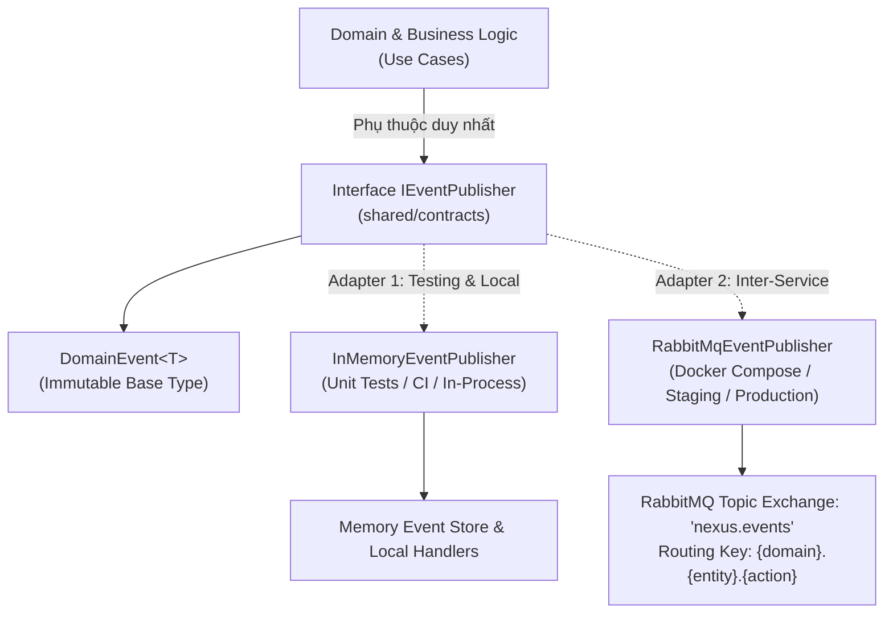

# 📊 BÁO CÁO SO SÁNH & ĐỀ XUẤT CƠ CHẾ EVENT CHO PHASE 0 (SCRUM-33)

> **Mục tiêu:** Phân tích, đánh giá và đề xuất cơ chế phát/nhận sự kiện (Domain Events) phù hợp nhất cho Phase 0 của Project Nexus, ghi nhận đầy đủ trade-offs để toàn đội ngũ Backend và DevOps thống nhất triển khai.

---

## 1. Bối Cảnh Hệ Thống & Yêu Cầu SRS (Context)

Project Nexus là nền tảng thương mại điện tử và đấu giá thời gian thực (E-Commerce & Real-Time Auction) xây dựng theo mô hình **Modular Monolith hướng Microservices** (7 Bounded Contexts: `api-gateway`, `user-service`, `catalog-service`, `commerce-service`, `auction-service`, `fulfillment-service`, `notification-service`).

Theo tài liệu **SRS 2.8 (Event Message Table)**:

- Toàn hệ thống có hơn 45 sự kiện nghiệp vụ cần được truyền thông bất đồng bộ giữa các module (ví dụ: khi `user-service` phát sinh `user.registered`, `notification-service` cần nhận để gửi email kích hoạt; khi `auction-service` phát sinh `auction.won`, `commerce-service` cần tạo đơn hàng tự động).
- **Mục tiêu Phase 0:** Xây dựng khung sườn hạ tầng, đảm bảo tính độc lập ranh giới (Bounded Context Isolation), hỗ trợ lập trình viên phát triển và chạy Unit Test / Integration Test tại máy cá nhân (Local Dev Experience) siêu tốc mà không bị tắc nghẽn bởi hạ tầng phức tạp, đồng thời sẵn sàng mở rộng khi triển khai môi trường phân tán (Docker Compose & Kubernetes).

---

## 2. So Sánh Chi Tiết 3 Phương Án Cơ Chế Event

| Tiêu Chí Đánh Giá                                   | Phương Án 1: In-Process Event _(ApplicationEventPublisher / EventEmitter / In-Memory)_                                                                    | Phương Án 2: AMQP Message Broker _(RabbitMQ via Docker)_                                                                                                         | Phương Án 3: Distributed Commit Log _(Apache Kafka)_                                                                                             |
| :-------------------------------------------------- | :----------------------------------------------------------------------------------------------------------------------------------------------------------- | :------------------------------------------------------------------------------------------------------------------------------------------------------------------ | :-------------------------------------------------------------------------------------------------------------------------------------------------- |
| **1. Độ phức tạp triển khai (Complexity)**          | ⭐⭐⭐⭐⭐ **Rất thấp** - Không cần thư viện ngoài. - Xử lý trực tiếp trong bộ nhớ tiến trình (Process Memory).                                        | ⭐⭐⭐⭐☆ **Trung bình** - Cần cài đặt client AMQP (`amqplib`). - Cấu hình Exchange, Queue, Routing Key và Dead Letter Queue (DLQ).                           | ⭐⭐☆☆☆ **Rất cao** - Đòi hỏi cụm ZooKeeper hoặc KRaft. - Cấu hình Partition, Consumer Group, Offset Management, Schema Registry phức tạp.    |
| **2. Trải nghiệm Local Dev (Local DX & Testing)**   | ⭐⭐⭐⭐⭐ **Xuất sắc** - Chạy ngay lập tức, không tốn RAM/CPU. - Chạy Unit Test tự động trên CI chỉ mất vài giây. - Không phụ thuộc Docker daemon. | ⭐⭐⭐⭐☆ **Rất tốt** - Đã được đóng gói sẵn trong `devops/docker-compose.dev.yml` (Port 5672, UI 15672). - Tốn khoảng ~100MB RAM.                            | ⭐⭐☆☆☆ **Nặng nề** - Chiếm từ 1.5GB - 3GB RAM trên máy cá nhân. - Thời gian khởi động lâu, dễ gây treo máy cấu hình yếu.                     |
| **3. Độ bền & Khả năng Retry (Durability & Retry)** | ⭐☆☆☆☆ **Kém** - Dữ liệu lưu trên RAM; khi tiến trình restart/crash sẽ mất toàn bộ event chưa xử lý. - Không hỗ trợ Dead Letter Queue liên tiến trình. | ⭐⭐⭐⭐⭐ **Rất cao** - Hỗ trợ Message Persistence (lưu đĩa). - Hỗ trợ xác nhận tin nhắn (`ack`/`nack`), tự động đẩy vào DLX khi lỗi quá số lần quy định.    | ⭐⭐⭐⭐⭐ **Cực cao** - Lưu log phân tán lâu dài (Retention policy). - Cho phép phát lại sự kiện từ đầu (Event Replay).                      |
| **4. Đáp ứng SRS 2.8 & Kiến trúc Phân Tán**         | ⭐⭐☆☆☆ **Hạn chế** - Chỉ hoạt động khi các module chạy chung 1 tiến trình Node.js. - Không gửi được tin nhắn giữa các container riêng biệt.           | ⭐⭐⭐⭐⭐ **Hoàn hảo** - Khớp 100% với mô hình Publish/Subscribe theo Topic Exchange (`nexus.events`) của SRS 2.8. - Độc lập hoàn toàn giữa 7 microservices. | ⭐⭐⭐⭐☆ **Dư thừa (Overkill)** - Phù hợp Big Data / High Throughput hàng triệu msg/sec. - Quá thừa thãi cho quy mô giai đoạn đầu của dự án. |

---

## 3. Lý Do Lựa Chọn & Đề Xuất Cho Phase 0

Nhóm Backend và DevOps thống nhất lựa chọn mô hình **Kiến trúc Cổng Kết Nối Đa Hình (Hexagonal Ports & Adapters / Dual-Driver Event Mechanism)**:

### Tại sao lựa chọn mô hình này?

1. **Tuân thủ nguyên lý đảo ngược phụ thuộc (DIP - Dependency Inversion Principle):** Toàn bộ nghiệp vụ ở tầng Application (`user-service`, `catalog-service`, ...) chỉ phụ thuộc vào interface `IEventPublisher` và lớp `DomainEvent<T>` dùng chung tại `@nexus/contracts`. Nghiệp vụ cốt lõi không biết và không quan tâm đằng sau là RabbitMQ, Kafka hay EventEmitter trong RAM.
2. **Tối ưu trải nghiệm phát triển & Tự động hóa CI (Local DX):**
   - Khi chạy Unit Test và CI (`pnpm test`), hệ thống sử dụng `InMemoryEventPublisher`. Test chạy tức thì (vài chục mili-giây), không cần bật Docker, không sợ lỗi treo mạng cổng 5672.
3. **Sẵn sàng cho môi trường phân tán (Distributed Environments):**
   - Khi chạy ứng dụng với Docker Compose (`docker:dev:up`), hệ thống chuyển sang `RabbitMqEventPublisher` để kết nối vào container `nexus-rabbitmq`, bảo đảm độ bền (Durability) và định tuyến Topic linh hoạt.
4. **Loại bỏ Kafka trong Phase 0:** Tránh gánh nặng tài nguyên và độ phức tạp vận hành không cần thiết trong giai đoạn xây dựng khung sườn.

---

## 4. Điều Kiện & Kế Hoạch Chuyển Đổi Sang Phase Tiếp Theo

- **Chuyển sang Phase 1:** Kích hoạt kết nối AMQP chính thức qua `amqplib` có cơ chế tự động kết nối lại (Auto-reconnect), xác thực tài khoản và cấu hình Dead Letter Exchange (`nexus.events.dlx`) cho toàn bộ 7 services.
- **Mở rộng tương lai (nếu cần Kafka / Cloud Pub/Sub):** Chỉ cần tạo thêm 1 Adapter mới (ví dụ: `KafkaEventPublisher implements IEventPublisher`) và cấu hình Dependency Injection mà **không cần sửa đổi bất kỳ dòng mã nghiệp vụ nào** trong các Bounded Contexts.

---

## 5. Kết Luận & Nghiệm Thu (Sign-off)

- **Quyết định:** Thông qua phương án Hexagonal Event Architecture với `IEventPublisher` + `DomainEvent<T>` (Base Type) + `InMemoryEventPublisher` (Testing) + `RabbitMqEventPublisher` (Cluster Runtime).
- **Tài liệu tham chiếu:** [`docs/adr/ADR-001-event-mechanism-phase-0.md`](file:///d:/Nexus/nexus-ecommerce/docs/adr/ADR-001-event-mechanism-phase-0.md).
