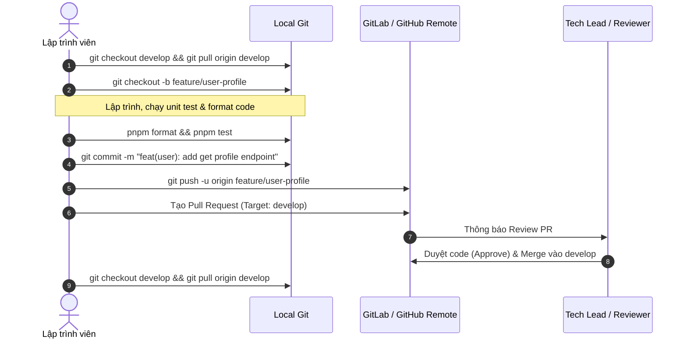

# Hướng Dẫn Quy Trình Phân Nhánh Git & Pull Request (GitFlow Workflow)

> **Tài liệu chuẩn hóa:** Project Nexus E-Commerce & Real-Time Auction Platform  
> **Áp dụng cho:** Toàn bộ thành viên phát triển Backend, Frontend, DevOps và Shared Contracts.

---

## 1. Mô Hình Phân Nhánh (Branching Strategy)

Dự án áp dụng mô hình **GitFlow chuẩn doanh nghiệp** nhằm đảm bảo tính ổn định của mã nguồn, phân định rõ ràng giữa môi trường phát triển (Development), kiểm thử (Staging) và triển khai thực tế (Production).

```text
  main (Production - Protected)
   │
   ├── [Release / Tag v1.0.0]
   │
  develop (Integration / Staging - Protected)
   │
   ├── feature/user-auth-iam (hoặc feat/be-user-auth-iam)
   ├── feature/catalog-search (hoặc feat/be-catalog-search)
   ├── feature/customer-portal (hoặc feat/fe-customer-auth-catalog)
   └── bugfix/fix-token-expiry (hoặc fix/be-token-expiry)
```

### 1.1. Các nhánh bảo vệ (Protected Branches)

| Tên nhánh     | Mục đích sử dụng                                                | Quyền hạn & Ràng buộc                                                                                                                                                            |
| :------------ | :-------------------------------------------------------------- | :------------------------------------------------------------------------------------------------------------------------------------------------------------------------------- |
| **`main`**    | Chứa mã nguồn ổn định nhất, sẵn sàng triển khai lên Production. | 🔒 **BẢO VỆ TUYỆT ĐỐI**: Cấm commit hoặc push trực tiếp. Chỉ nhận code thông qua Pull Request / Merge Request từ nhánh `develop` sau khi đã qua kiểm thử UAT và CI/CD pass 100%. |
| **`develop`** | Nhánh tích hợp mã nguồn chính của cả nhóm trong từng Sprint.    | 🔒 **BẢO VỆ**: Cấm commit trực tiếp. Tất cả tính năng mới của các thành viên đều phải tạo Pull Request hướng về nhánh này.                                                       |

### 1.2. Các nhánh làm việc hàng ngày (Working Branches)

Mọi thành viên **bắt buộc tạo nhánh mới tách ra từ `develop`**:

1. **Nhánh Tính Năng Mới (`feature/*` hoặc `feat/*`):**
   - Đặt tên theo cú pháp: `feature/<tên-tính-năng>` hoặc `feat/<scope>-<tên-ngắn>`
   - Ví dụ:
     - `feature/user-registration`
     - `feat/be-user-auth-iam`
     - `feat/fe-customer-catalog`
     - `feat/shared-contracts-events`
2. **Nhánh Sửa Lỗi (`fix/*` hoặc `bugfix/*`):**
   - Đặt tên theo cú pháp: `fix/<tên-lỗi>` hoặc `bugfix/<scope>-<tên-lỗi>`
   - Ví dụ: `fix/be-catalog-filter`, `bugfix/fe-cart-calc`
3. **Nhánh Khẩn Cấp (`hotfix/*`):**
   - Dùng khi phát hiện lỗi nghiêm trọng trên Production (nhánh `main`).
   - Tách trực tiếp từ `main`, sửa lỗi, sau đó merge đồng thời vào cả `main` và `develop`.
   - Ví dụ: `hotfix/stripe-webhook-signature`
4. **Nhánh Cấu Hình / Bảo Trì (`chore/*`):**
   - Dùng cho DevOps, docker, dependencies: `chore/devops-docker-environment`

---

## 2. Quy Trình Làm Việc Từng Bước Cho Thành Viên Mới (Step-by-Step Workflow)



### Bước 1: Luôn cập nhật nhánh `develop` trước khi bắt đầu

```bash
git checkout develop
git pull origin develop
```

### Bước 2: Tạo nhánh tính năng mới theo đúng quy ước

```bash
# Ví dụ tạo nhánh làm tính năng xem thông tin cá nhân:
git checkout -b feat/be-user-profile

# Hoặc:
git checkout -b feature/user-profile
```

> **Lưu ý:** Script [`scripts/verify-branch-name.js`](file:///d:/CodeProject/nexus-ecommerce/nexus-ecommerce-main/scripts/verify-branch-name.js) được kích hoạt tự động qua Husky Git hook. Nếu bạn đặt tên nhánh không đúng quy ước hoặc vô tình commit trên `main`, Git sẽ từ chối commit ngay lập tức.

### Bước 3: Lập trình & kiểm tra chất lượng tại máy local

Trước khi commit, hãy đảm bảo toàn bộ mã nguồn sạch sẽ, không có lỗi định dạng hay vi phạm kiến trúc:

```bash
# 1. Tự động format toàn bộ code theo chuẩn Prettier
pnpm format

# 2. Chạy toàn bộ test kiểm tra hạ tầng và ranh giới kiến trúc ArchUnit
pnpm test
```

### Bước 4: Commit mã nguồn theo chuẩn Conventional Commits

Dự án tích hợp công cụ `@commitlint/cli` để chuẩn hóa lịch sử commit. Cú pháp bắt buộc:

$$\text{<type>}(\text{<scope>}): \text{<description>}$$

- **`<type>`** bao gồm:
  - `feat`: Tính năng mới (ví dụ: `feat(user): add get profile endpoint`)
  - `fix`: Sửa lỗi (ví dụ: `fix(catalog): resolve pagination offset bug`)
  - `docs`: Thêm hoặc cập nhật tài liệu (ví dụ: `docs(readme): update onboarding instructions`)
  - `chore`: Thay đổi cấu hình build, dependencies (ví dụ: `chore(deps): bump prisma to 5.x`)
  - `refactor`: Tái cấu trúc mã nguồn không đổi hành vi (ví dụ: `refactor(auth): simplify jwt verify helper`)
  - `test`: Thêm hoặc cập nhật unit test (ví dụ: `test(arch): add boundary check for order module`)
- **`<scope>`**: Tên module liên quan (`user`, `catalog`, `commerce`, `auction`, `fulfillment`, `notification`, `gateway`, `devops`, `shared`, `fe-customer`, `fe-admin`).

```bash
git add .
git commit -m "feat(user): implement get user profile use case"
```

### Bước 5: Đẩy nhánh lên Remote Repository

```bash
git push -u origin feat/be-user-profile
```

### Bước 6: Tạo Pull Request (PR) / Merge Request (MR)

1. Mở giao diện GitLab / GitHub của dự án.
2. Nhấn nút **Create Merge Request / New Pull Request**:
   - **Source branch:** Nhánh tính năng của bạn (ví dụ: `feat/be-user-profile`).
   - **Target branch:** **`develop`** _(TUYỆT ĐỐI KHÔNG CHỌN `main`)_.
3. Điền tiêu đề và mô tả theo biểu mẫu (PR Template):
   - **Tóm tắt thay đổi:** Mô tả những gì bạn đã làm.
   - **Căn cứ SRS / Ticket:** Ghi mã ticket (ví dụ: SCRUM-12, SRS 3.1).
   - **Kết quả kiểm thử:** Đính kèm ảnh chụp `pnpm test` chạy thành công (37/37 tests passed).
4. Gán ít nhất 1 thành viên trong nhóm làm **Reviewer**.
5. Sau khi nhận được ít nhất 1 **Approval** và toàn bộ CI/CD Pipeline chạy XANH, PR sẽ được merge vào `develop`.

---

## 3. Quy Tắc Bảo Mật & Ngăn Chặn Rò Rỉ Secret (Security Rules)

1. **Tuyệt đối không commit file `.env`:**
   - File `.env` chứa mật khẩu database, secret key JWT, token Stripe, v.v.
   - File này đã được thêm vào [`.gitignore`](file:///d:/CodeProject/nexus-ecommerce/nexus-ecommerce-main/.gitignore).
   - Khi cần thêm biến môi trường mới: Hãy cập nhật vào file mẫu [`.env.example`](file:///d:/CodeProject/nexus-ecommerce/nexus-ecommerce-main/.env.example) với giá trị giả lập (dummy placeholder) để các thành viên khác biết và cấu hình.
2. **Không commit file build hoặc mã máy:**
   - Thư mục `node_modules/`, `dist/`, `.next/`, `target/`, file `*.jar`, `*.tsbuildinfo` đều bị cấm tuyệt đối nhằm giữ cho Git repo nhẹ và tránh xung đột binary.
3. **Nếu vô tình commit secret lên Git:**
   - Báo ngay cho Tech Lead để thu hồi (revoke) key đó trên dịch vụ gốc và thay thế bằng key mới.

---

## 4. Checklist Tự Kiểm Tra Trước Khi Tạo PR

- [ ] Nhánh làm việc được tách từ `develop` mới nhất.
- [ ] Tên nhánh đúng quy chuẩn (`feature/*`, `feat/*`, `fix/*`, `chore/*`).
- [ ] File [`.env`](file:///d:/CodeProject/nexus-ecommerce/nexus-ecommerce-main/.env) không bị đưa vào Git (`git status` không hiển thị file `.env` hay credentials).
- [ ] Đã chạy `pnpm format` không có cảnh báo.
- [ ] Đã chạy `pnpm test` pass 100% (Infrastructure + ArchUnit Architecture Boundaries).
- [ ] Commit message tuân thủ đúng chuẩn Conventional Commits.
- [ ] Target branch của PR là `develop`.
