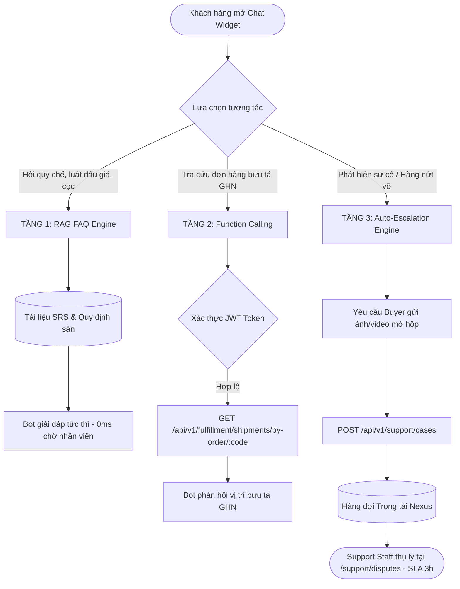

# Đề Xuất Thiết Kế & Tích Hợp Chatbot Toàn Diện Cho Dự Án Nexus E-Commerce

Tài liệu này tổng hợp phân tích, đánh giá nhược điểm của 3 hướng tiếp cận ban đầu và làm rõ **lý do cốt lõi** tại sao nhóm nên triển khai theo giải pháp **"Hybrid 3-trong-1 Waterfall"** trong kiến trúc dự án **Nexus E-Commerce**.

---

## 1. Tóm Tắt 3 Hướng Thiết Kế Chatbot Ban Đầu (Dựa trên Đặc Tả Backend)

| Kịch bản                                                   | Bản chất kỹ thuật                                                                                                                                                                    | Giá trị mong đợi                                                                                                  | Minh họa thực tế                                                                                                                                        |
| :--------------------------------------------------------- | :----------------------------------------------------------------------------------------------------------------------------------------------------------------------------------- | :---------------------------------------------------------------------------------------------------------------- | :------------------------------------------------------------------------------------------------------------------------------------------------------ |
| **Kịch bản A: Functional Chatbot** _(Self-Service Orders)_ | LLM nhận diện ý định `CHECK_SHIPPING_STATUS`, trích xuất `orderCode` $\rightarrow$ Kích hoạt **Function Calling** gọi API (`GET /api/v1/fulfillment/shipments/by-order/:orderCode`). | Khách tự tra cứu trạng thái đơn hàng, tiến độ bưu tá GHN tức thì.                                                 | _"Đơn hàng NX-ORD-8021 của tôi đến đâu rồi?"_ $\rightarrow$ Bot gọi API GHN $\rightarrow$ Báo bưu tá đang giao trong chiều nay.                         |
| **Kịch bản B: Informational Chatbot** _(RAG FAQ)_          | Đưa toàn bộ tài liệu đặc tả (SRS 2.4, 2.7, quy chế sàn, luật cọc, quy định đấu giá) vào Vector Database để tìm kiếm ngữ nghĩa (**RAG**).                                             | Giải đáp 70% thắc mắc lặp lại chuẩn xác 100% theo quy chế, chống hallucination.                                   | _"Khi nào tôi bị mất cọc đấu giá?"_ $\rightarrow$ Bot trích xuất điều khoản SRS: thắng cuộc không thanh toán trong 24h bị mất cọc & trừ 10 điểm uy tín. |
| **Kịch bản C: Escalation Chatbot** _(Auto-Escalation)_     | Phân tích cảm xúc (`Sentiment: NEGATIVE`) + phân loại sự cố (`DISPUTE_DAMAGE`) $\rightarrow$ Thu thập ảnh mở hộp $\rightarrow$ Gọi API tạo Ticket (`POST /api/v1/support/cases`).    | Đưa khiếu nại của khách thẳng vào hàng đợi phân xử của nhân viên hỗ trợ (**Support Staff**) theo cam kết **SLA**. | Khách báo hàng nứt vỡ $\rightarrow$ Bot thu thập ảnh mở hộp $\rightarrow$ Mở ticket `CS-4029` chuyển sang `/support/disputes` xử lý trong 3h.           |

---

## 2. Phân Tích Nhược Điểm Của Từng Plan Khi Triển Khai Riêng Lẻ

Nếu hệ thống chỉ chọn làm **đơn lẻ** 1 trong 3 kịch bản trên, dự án sẽ vấp phải các nhược điểm nghiêm trọng sau:

### 2.1. Nhược điểm nếu CHỈ LÀM Kịch bản A (Functional Chatbot - Tra cứu đơn)

1. **Phạm vi sử dụng quá hẹp (Narrow Scope):** Khách hàng chỉ tương tác khi đã có đơn hàng phát sinh và đang trong quá trình vận chuyển. Đối với khách hàng mới, khách đang tìm hiểu sản phẩm, hoặc khách tham gia phòng đấu giá trực tiếp, bot hoàn toàn **vô dụng**.
2. **Ngõ cụt trải nghiệm (Dead-End UX khi có sự cố):** Khi đơn hàng gặp trục trặc (bưu tá giao thất bại, hàng hỏng, delay nhiều ngày), bot chỉ biết "đọc lại" trạng thái mà không có bất kỳ công cụ nào để giúp khách khiếu nại hay gặp nhân viên $\rightarrow$ gây ức chế tột độ cho người mua.
3. **Rủi ro bảo mật & lộ thông tin (IDOR):** Nếu chỉ dựa vào mã đơn hàng khách gõ vào khung chat mà không gắn chặt với JWT Session của tài khoản đăng nhập, kẻ xấu có thể thử các mã đơn hàng khác để xem địa chỉ nhà và số điện thoại của người khác.

### 2.2. Nhược điểm nếu CHỈ LÀM Kịch bản B (RAG FAQ - Trả lời chính sách & Đấu giá)

1. **Thụ động và thiếu tính hành động (No-Action / Informational Only):** Chatbot chỉ đóng vai trò như một thanh "Google Search" tài liệu SRS. Khách đọc xong quy định vẫn phải tự tìm đường link, tự bấm qua các trang khác để thực hiện hành động (như tự mở trang tra cứu vận đơn, tự đi tìm form gửi khiếu nại).
2. **Trải nghiệm vô cảm khi khách gặp khủng hoảng:** Khi khách hàng phàn nàn vì nhận phải hàng nứt vỡ, việc bot trả lời máy móc: _"Theo điều 2.7 tài liệu SRS, quý khách được quyền đổi trả trong 48 giờ..."_ mà không hề hỗ trợ thu thập ảnh hay mở ticket sẽ khiến khách cảm thấy sàn đang thoái thác trách nhiệm.
3. **Ảo giác ngữ cảnh tài khoản (Personal Context Hallucination):** RAG chỉ đọc được văn bản tĩnh, không truy vấn được trạng thái động của người dùng (ví dụ: _"Tài khoản của tôi hiện có bao nhiêu điểm uy tín để cọc món này?"_ thì bot RAG thuần túy sẽ trả lời sai hoặc không biết).

### 2.3. Nhược điểm nếu CHỈ LÀM Kịch bản C (Escalation Chatbot - Tạo Ticket cho Support)

1. **Gây quá tải nghiêm trọng cho đội ngũ Support Staff (Ticket Flooding):** Mọi thắc mắc từ nhỏ nhặt (hỏi giờ bưu tá làm việc, hỏi cách nạp tiền cọc, kiểm tra đơn) đều bị đẩy thành Ticket hoặc gọi nhân viên $\rightarrow$ Support Staff ngập lụt trong hàng trăm ticket rác, dẫn đến **vỡ cam kết thời hạn giải quyết (SLA 3 giờ)**.
2. **Lãng phí thời gian và làm giảm hài lòng của khách:** Khách chỉ muốn biết vị trí đơn hàng ngay lập tức nhưng lại phải chờ từ 1 - 3 giờ để nhân viên hỗ trợ đọc ticket và trả lời thủ công.
3. **Chi phí vận hành tăng cao:** Đòi hỏi số lượng nhân sự trực ban lớn để tiếp nhận luồng ticket khổng lồ thay vì tận dụng AI để tự động hóa các tác vụ lặp lại.

---

## 3. Mô Hình Đề Xuất Tối Ưu Nhất: "Hybrid 3-Trong-1 Waterfall"

Thay vì chọn 1 trong 3, giải pháp tốt nhất là **hợp nhất cả 3 kịch bản vào một Chatbot Widget duy nhất** và vận hành theo cơ chế phân tầng (Waterfall Pipeline):

---

## 4. Tại Sao Nên Làm Theo Hướng Đề Xuất Tối Ưu Này? (Lý Do Cốt Lõi)

### 4.1. Tính tương hỗ và bù trừ hoàn hảo (Complementary Synergy)

Ba kịch bản này thực chất là **3 giai đoạn kế tiếp nhau** trong hành trình trải nghiệm của khách hàng (Customer Journey):

- **Giai đoạn trước mua & đấu giá:** Khách dùng **Kịch bản B** để nắm rõ luật chơi, điều kiện cọc, tránh bị phạt điểm uy tín.
- **Giai đoạn sau mua (Post-checkout):** Khách dùng **Kịch bản A** để tự theo dõi lộ trình bưu tá GHN 24/7.
- **Giai đoạn phát sinh sự cố:** Hệ thống tự động chuyển tiếp từ **A $\rightarrow$ C**, nhận diện bức xúc, thu thập bằng chứng ảnh chụp và kích hoạt luồng trọng tài.

### 4.2. Bộ lọc 2 lớp bảo vệ cam kết SLA của Support Staff

- **Lớp 1:** Tự động giải quyết **70%** thắc mắc chính sách bằng RAG FAQ.
- **Lớp 2:** Tự động giải quyết **20%** nhu cầu tra cứu đơn hàng bằng Function Calling.
- **Kết quả:** Chỉ còn **10%** trường hợp thực sự có lỗi vận chuyển hoặc hư hại sản phẩm mới được chuyển thành Ticket cho nhân viên. Điều này đảm bảo Support Staff luôn xử lý hồ sơ đúng thời hạn cam kết **SLA 3 giờ**.

### 4.3. Khép kín luồng nghiệp vụ với màn hình Support đã xây dựng

Dự án của nhóm đã có sẵn module **Trọng tài khiếu nại (`/support/disputes`)**. Khi áp dụng hướng Hybrid:

- Chatbot đóng vai trò là "cổng thu thập dữ liệu đầu vào" (Input Collector) ở phía Người mua.
- Màn hình Trọng tài đóng vai trò là "nơi xử lý phán quyết" (Action Center) ở phía Nhân viên vận hành.
  $\rightarrow$ Tạo nên một chuỗi giá trị nghiệp vụ hoàn chỉnh (End-to-End Flow), thể hiện tư duy thiết kế phần mềm trưởng thành trước Mentor.

### 4.4. Trải nghiệm người dùng đồng nhất (All-in-One Experience)

Khách hàng không bao giờ bị rơi vào "ngõ cụt" (Dead-end). Mọi tình huống phát sinh đều có hướng xử lý tiếp theo rõ ràng ngay trong cùng một cửa sổ chat.

---

## 5. Thiết Kế Giao Diện UI/UX & Ma Trận Tương Tác Vai Trò

### 5.1. Thiết Kế Giao Diện Trên Web Frontend

1. **Vị Trí & Hiển Thị:** Nút bấm nổi (Floating Action Button) tại góc phải dưới màn hình (`bottom-6 right-6 z-50`) trên các giao diện Người mua (`/`, `/products`, `/orders`, `/cart`).
2. **Kích Thước Cửa Sổ Chat:** Popover trượt mượt mà `380px x 540px`, tiêu đề: _"Nexus AI Assistant - Hỗ trợ trực tuyến 24/7"_.
3. **Nút Thao Tác Nhanh (Quick Action Chips):**
   - `📦 Tra cứu đơn hàng gần nhất`
   - `⚖️ Quy định đặt cọc & Đấu giá`
   - `🚨 Báo lỗi hàng / Yêu cầu đổi trả`
4. **Input Đính Kèm File:** Tích hợp nút kẹp ghim 📎 để upload ảnh mở hộp khiếu nại trực tiếp trong luồng chat.

### 5.2. Ma Trận Tương Tác Giữa Các Vai Trò

| Cặp tương tác                             | Kênh thực hiện                        | Trách nhiệm & Quyền hạn                                                                                                                                    |
| :---------------------------------------- | :------------------------------------ | :--------------------------------------------------------------------------------------------------------------------------------------------------------- |
| **Buyer $\leftrightarrow$ AI Chatbot**    | Khung chat nổi trên Web Buyer         | Giải đáp quy chế sàn, tra cứu vận đơn, thu thập thông tin khiếu nại tự động 24/7.                                                                          |
| **Buyer $\leftrightarrow$ Support Staff** | Gián tiếp qua Ticket Case (`CS-xxxx`) | Chatbot tổng hợp bằng chứng $\rightarrow$ Chuyển hồ sơ lên màn hình `/support/disputes` $\rightarrow$ Support Staff phán quyết hoàn tiền/đổi trả theo SLA. |
| **Buyer $\leftrightarrow$ Seller**        | Không mở chat trực tiếp (Khuyến nghị) | Toàn bộ giao dịch và khiếu nại được sàn Nexus đứng ra bảo chứng, tránh gian lận cọc và giao dịch ngầm ngoài sàn.                                           |

---

## 6. Luận Điểm "Ghi Điểm Tuyệt Đối" Khi Báo Cáo Với Mentor

Khi báo cáo với Mentor hoặc hội đồng phản biện, hãy nhấn mạnh 3 luận điểm kiến trúc sau:

1. **"Chúng em không làm Chatbot trò chuyện thông thường, mà tích hợp Chatbot như một Orchestrator điều phối nghiệp vụ."**
2. **"Chatbot được trang bị bộ lọc phân tầng: 70% FAQ, 20% tự phục vụ tra cứu, chỉ 10% sự cố nghiêm trọng mới tạo ticket, giúp bộ phận Support Staff không bao giờ bị vi phạm cam kết SLA 3 giờ."**
3. **"Khâu tiếp nhận khiếu nại của Chatbot được liên kết thời gian thực với trang Trọng tài tranh chấp `/support/disputes` mà nhóm đã phát triển, tạo nên luồng vận hành khép kín hoàn chỉnh từ Người mua đến Nhân viên hỗ trợ."**
