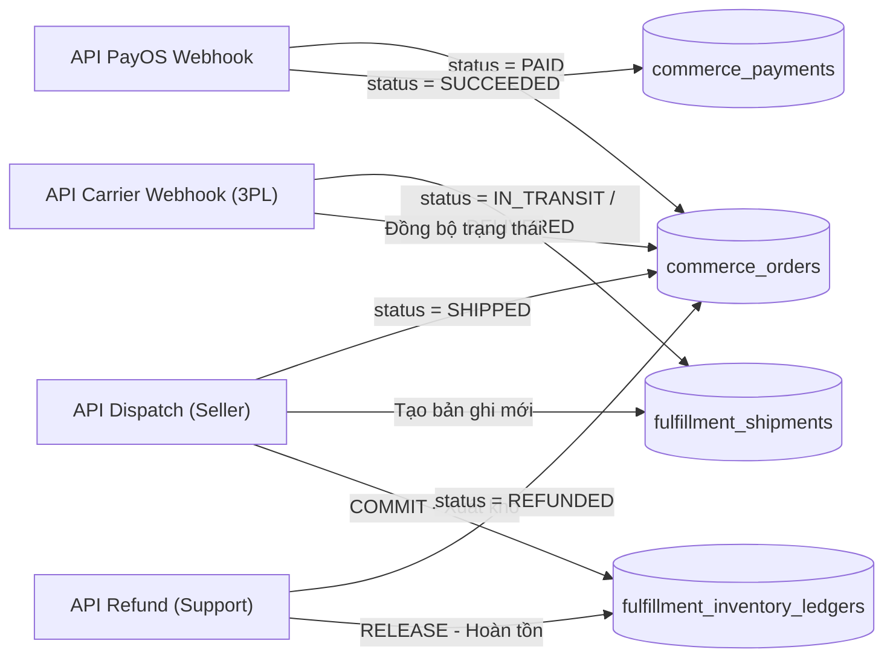

# Tài Liệu Bàn Giao Kỹ Thuật API: Luồng Sau Checkout, Vận Chuyển 3PL & Phân Hệ Seller/Support

> **Tài liệu đặc tả hợp đồng API (API Specification & Handoff) dành riêng cho Backend Team (BE).**  
> **Người bàn giao:** Frontend Team (FE2 - Phụ trách phân hệ Người bán & Hỗ trợ khách hàng).  
> **Dịch vụ Backend liên quan:** `commerce-service` (Port 5434), `fulfillment-service` (Port 5436), `notification-service` (Port 4006), `api-gateway` (Port 8080).  
> **Đường dẫn cơ sở qua Gateway:** `/api/v1/...`  
> **Trạng thái FE hiện tại:** Giao diện Seller & Support đã dựng hoàn chỉnh các nút bấm, tab lọc, modal in ấn và bộ giả lập; đang chạy chế độ mô phỏng client-side và chờ kết nối API bền vững từ BE.

---

## 1. Bối Cảnh Nghiệp Vụ & Nhu Cầu Tích Hợp

Trong luồng thanh toán E-Commerce hiện đại của Nexus:

1. **Sau khi Buyer thanh toán PayOS thành công:** Tiền về tài khoản sàn $\rightarrow$ PayOS bắn Webhook $\rightarrow$ Đơn hàng chuyển sang `PAID`.
2. **Người bán (Seller):** Mở màn hình `/seller/orders` thấy đơn hàng ở tab **"Chờ giao (PAID)"**, tiến hành đóng gói hàng vật lý, in phiếu gửi hàng (`🖨️ In phiếu gửi hàng`) dán lên thùng carton, rồi bấm nút **`✓ Xác nhận & Bàn giao ĐVVC`**.
3. **Đơn vị vận chuyển 3PL (GHN / GHTK API Developer):** Hệ thống tự động đẩy thông tin kiện hàng sang bên giao vận để nhận mã vận đơn (`trackingCode`). Khi tài xế Shipper đến bốc hàng đi giao và khi giao thành công, hệ thống 3PL bắn Webhook về Nexus để cập nhật trạng thái tự động 100%.
4. **Bộ phận Hỗ trợ (Support Staff):** Không can thiệp đơn giao hàng thông thường! Chỉ xử lý khi có cờ tranh chấp **`REFUND_REQUESTED`** (Khách khiếu nại hàng vỡ, sai mẫu). Khung công cụ cập nhật trạng thái trên Support UI hiện tại được định vị là **"Bộ giả lập 3PL Carrier Webhook (Simulator)"** phục vụ demo đồ án khi chưa có tài xế ngoài đời thực.

---

## 2. Bảng Tổng Hợp Danh Mục API (Priority Matrix)

|  STT  | Phương thức | Endpoint Gateway                                  | Bounded Context       | Quyền / Role truy cập          |        Độ ưu tiên         |
| :---: | :---------: | :------------------------------------------------ | :-------------------- | :----------------------------- | :-----------------------: |
| **1** |   `POST`    | `/api/v1/payments/payos/webhook`                  | `commerce-service`    | Public (Xác thực chữ ký HMAC)  |     **P0** (Bắt buộc)     |
| **2** |    `GET`    | `/api/v1/orders/:id/payment-status`               | `commerce-service`    | `BUYER` (Chính chủ đơn)        |     **P0** (Bắt buộc)     |
| **3** |   `POST`    | `/api/v1/orders/:id/dispatch`                     | `commerce-service`    | `SELLER` (Chủ shop đơn hàng)   |     **P0** (Bắt buộc)     |
| **4** |   `POST`    | `/api/v1/fulfillment/carriers/webhook`            | `fulfillment-service` | Public (Token đối tác 3PL)     |     **P0** (Bắt buộc)     |
| **5** |   `POST`    | `/api/v1/orders/:id/refund/request`               | `commerce-service`    | `BUYER` (Chính chủ đơn)        |    **P1** (Nghiệp vụ)     |
| **6** |   `POST`    | `/api/v1/orders/:id/refund`                       | `commerce-service`    | `SUPPORT_STAFF` / `ADMIN`      |   **P1** (Đã có route)    |
| **7** |   `POST`    | `/api/v1/orders/:id/refund/cancel`                | `commerce-service`    | `SUPPORT_STAFF` / `ADMIN`      |   **P1** (Đã có route)    |
| **8** |    `GET`    | `/api/v1/fulfillment/shipments/by-order/:orderId` | `fulfillment-service` | `SELLER` / `BUYER` / `SUPPORT` | **P1** (In ấn & Tracking) |

---

## 3. Đặc Tả Chi Tiết Từng Endpoint (Contract-First Specification)

### 3.1. API 1: Webhook Tiếp Nhận Thanh Toán PayOS

- **Endpoint:** `POST /api/v1/payments/payos/webhook`
- **Service xử lý:** `commerce-service`
- **Mục đích:** PayOS tự động gọi đến server Nexus ngay sau khi khách quét VietQR thanh toán thành công.

#### Yêu cầu kỹ thuật Backend:

1. **Xác thực chữ ký số:** Kiểm tra tính toàn vẹn dữ liệu bằng `PAYOS_CHECKSUM_KEY` (HMAC SHA256). Nếu sai chữ ký $\rightarrow$ Trả về `400 Bad Request`.
2. **Xử lý Idempotency:** Kiểm tra mã giao dịch `data.paymentLinkId` hoặc `data.reference`. Nếu đã ghi nhận thanh toán trong DB thì trả ngay HTTP 200 `{ "success": true, "message": "Already processed" }` (chống trừ tiền / cập nhật 2 lần).
3. **Cập nhật Database:**
   ```sql
   UPDATE commerce_orders SET status = 'PAID', updated_at = NOW() WHERE order_code = :orderCode;
   UPDATE commerce_payments SET status = 'SUCCEEDED', transaction_id = :paymentLinkId, updated_at = NOW() WHERE order_id = :orderId;
   ```
4. **Phát Domain Event lên RabbitMQ (`nexus.events`):**
   - Event Type: `order.paid`
   - Payload:
     ```json
     {
       "orderId": "01a15822-...",
       "buyerId": "01a15822-...",
       "amountPaid": 25000000,
       "paymentMethod": "PAYOS_VIETQR",
       "paidAt": "2026-11-04T12:00:00.000Z"
     }
     ```

#### Response chuẩn:

```json
{
  "code": "00",
  "desc": "Success",
  "data": null
}
```

---

### 3.2. API 2: Tra Cứu Trạng Thái Thanh Toán Thực Tế Của Đơn Hàng

- **Endpoint:** `GET /api/v1/orders/:id/payment-status`
- **Service xử lý:** `commerce-service`
- **Mục đích:** Khi PayOS redirect trình duyệt của Buyer về trang `/checkout/result?orderCode=...`, Frontend **không bao giờ tin tham số URL** mà sẽ gọi API này để lấy kết quả xác thực từ DB.
- **Header:** `Authorization: Bearer <JWT_BUYER>`

#### Response thành công (HTTP 200):

```json
{
  "success": true,
  "data": {
    "orderId": "01a15822-...",
    "orderCode": "ORD-20261104-001",
    "status": "PAID",
    "isPaid": true,
    "totalAmount": 25000000,
    "paidAt": "2026-11-04T12:05:00.000Z",
    "paymentMethod": "PAYOS_VIETQR",
    "transactionId": "payos_link_9928172"
  }
}
```

---

### 3.3. API 3: Người Bán Xác Nhận Đóng Gói & Bàn Giao ĐVVC (Dispatch)

- **Endpoint:** `POST /api/v1/orders/:id/dispatch`
- **Service xử lý:** `commerce-service` $\rightarrow$ gọi sang `fulfillment-service`
- **Mục đích:** Kích hoạt khi Người bán (Seller) bấm nút **`✓ Xác nhận & Bàn giao ĐVVC`** trên trang `/seller/orders`.
- **Header:** `Authorization: Bearer <JWT_SELLER>` (Quyền: `ORDER.DISPATCH` hoặc Seller sở hữu đơn).

#### Request Body DTO:

```json
{
  "note": "Hàng dễ vỡ, xin nhẹ tay",
  "carrierPreference": "GHN" // Mặc định GHN Sandbox
}
```

#### Quy trình xử lý tại Backend:

1. Kiểm tra đơn hàng có thuộc về `seller_id` của token hiện tại hay không (chống Seller A dispatch đơn của Seller B).
2. Kiểm tra trạng thái đơn: Phải là `PAID` hoặc `PROCESSING`. (Nếu đơn đang `PENDING_PAYMENT` hoặc đã `CANCELLED` thì trả lỗi `409 Conflict: Đơn hàng chưa thanh toán hoặc đã hủy`).
3. **Tương tác với `fulfillment-service`:**
   - Tạo bản ghi mới trong bảng `fulfillment_shipments` với trạng thái `PENDING` / `READY_TO_PICK`.
   - Kết nối API Sandbox 3PL (ví dụ GHN Sandbox: `POST /v2/shipping-order/create`) truyền địa chỉ kho của Seller và địa chỉ của Buyer $\rightarrow$ Nhận về `trackingCode` thật (ví dụ `GHN12345678VN`).
4. Cập nhật `commerce_orders.status = 'SHIPPED'` (hoặc `PROCESSING`).
5. Ghi nhận 1 bước vào lịch sử `timeline`: _"Đã bàn giao kiện hàng cho ĐVVC. Mã vận đơn: GHN12345678VN"_.

#### Response thành công (HTTP 200):

```json
{
  "success": true,
  "data": {
    "orderId": "01a15822-...",
    "status": "SHIPPED",
    "tracking": "GHN12345678VN",
    "carrier": "Giao Hàng Nhanh (GHN)",
    "dispatchedAt": "2026-11-04T12:30:00.000Z",
    "message": "Đã điều phối đơn vị vận chuyển thành công. Shipper sẽ đến lấy hàng trong 24h."
  }
}
```

---

### 3.4. API 4: Webhook Nhận Lộ Trình Giao Hàng Từ Đối Tác 3PL (GHN / GHTK)

- **Endpoint:** `POST /api/v1/fulfillment/carriers/webhook`
- **Service xử lý:** `fulfillment-service`
- **Mục đích:** Đối tác giao hàng (hoặc Bộ giả lập Simulator trên màn hình Support) gửi dữ liệu tiến độ giao hàng về hệ thống.

#### Payload DTO gửi từ 3PL:

```json
{
  "carrier": "GHN",
  "trackingCode": "GHN12345678VN",
  "status": "DELIVERED", // Các giá trị: PICKED, IN_TRANSIT, OUT_FOR_DELIVERY, DELIVERED, FAILED, RETURNED
  "location": "Bưu cục Phường Bến Nghé, Quận 1, TP.HCM",
  "note": "Người nhận đã ký nhận bưu phẩm đầy đủ",
  "updatedAt": "2026-11-04T15:30:00.000Z"
}
```

#### Quy trình xử lý tại Backend:

1. Đối chiếu `trackingCode` trong bảng `fulfillment_shipments`.
2. Cập nhật `fulfillment_shipments.status = payload.status` và `fulfillment_shipments.current_location = payload.location`.
3. **Đồng bộ ngược sang `commerce-service`:**
   - Nếu `status == 'DELIVERED'` $\rightarrow$ Cập nhật `commerce_orders.status = 'DELIVERED'`, ghi nhận `delivered_at = NOW()`.
   - Nếu `status == 'RETURNED'` $\rightarrow$ Cập nhật `commerce_orders.status = 'REFUNDED'` hoặc `'CANCELLED'`.
4. **Phát Domain Event `shipment.status_updated`:**
   - `notification-service` lắng nghe event này để gửi thông báo Socket realtime cho Buyer & Seller: _"Đơn hàng GHN123... của bạn đã được giao thành công!"_.

#### Response thành công (HTTP 200):

```json
{
  "success": true,
  "message": "Shipment status updated successfully"
}
```

---

### 3.5. API 5: Người Mua Gửi Yêu Cầu Trả Hàng / Hoàn Tiền (Dispute Request)

- **Endpoint:** `POST /api/v1/orders/:id/refund/request`
- **Service xử lý:** `commerce-service`
- **Mục đích:** Khi khách nhận hàng nhưng phát hiện hàng vỡ hỏng, sai mô tả, khách bấm nút "Yêu cầu Trả hàng / Hoàn tiền".
- **Header:** `Authorization: Bearer <JWT_BUYER>`

#### Request Body DTO:

```json
{
  "reason": "Hàng bị vỡ màn hình trong lúc vận chuyển",
  "evidenceUrls": [
    "https://storage.nexus.com/evidence/img_001.jpg",
    "https://storage.nexus.com/evidence/video_unboxing.mp4"
  ]
}
```

#### Quy trình xử lý tại Backend:

1. Kiểm tra đơn hàng: Phải có `buyer_id` khớp với JWT, trạng thái đơn phải là `DELIVERED` và trong vòng **7 ngày** kể từ ngày giao.
2. Cập nhật `commerce_orders.status = 'REFUND_REQUESTED'`.
3. Lưu vết bằng chứng vào bảng khiếu nại (hoặc lưu trường JSON `dispute_info` trong Order).
4. Khóa số tiền thanh toán của đơn (tạm giữ trong ví ký quỹ Escrow của sàn, chưa cho rút về tài khoản Seller).
5. Bắn thông báo đến màn hình Support: _"Đơn hàng ORD-... có khiếu nại mới cần trọng tài giải quyết"_.

#### Response thành công (HTTP 200):

```json
{
  "success": true,
  "data": {
    "orderId": "01a15822-...",
    "status": "REFUND_REQUESTED",
    "message": "Yêu cầu hoàn tiền đã được gửi. Bộ phận CSKH sẽ phản hồi trong vòng 24-48 giờ làm việc."
  }
}
```

---

### 3.6. API 6: Nhân Viên Hỗ Trợ Phê Duyệt Hoàn Tiền (Refund Approval)

- **Endpoint:** `POST /api/v1/orders/:id/refund` _(Backend đã có route, cần hoàn thiện logic thật)_
- **Service xử lý:** `commerce-service`
- **Mục đích:** Kích hoạt khi Support Staff xác minh lỗi thuộc về Người bán hoặc bên vận chuyển và bấm nút **`Xử lý hoàn tiền`** trên trang `/support/orders/[id]`.
- **Header:** `Authorization: Bearer <JWT_SUPPORT>` (Quyền: `ORDER.REFUND`).

#### Request Body DTO:

```json
{
  "reason": "Chấp thuận khiếu nại: Sản phẩm vỡ hỏng do lỗi đóng gói của người bán."
}
```

#### Quy trình xử lý tại Backend:

1. Đổi `commerce_orders.status = 'REFUNDED'`.
2. Ghi nhận giao dịch hoàn tiền trong bảng `commerce_payments` (`status = 'REFUNDED'`).
3. Gọi cổng thanh toán PayOS (Refund API) hoặc hoàn số dư vào tài khoản Buyer.
4. Phát Domain Event `order.refunded` $\rightarrow$ `fulfillment-service` tự động nhả tồn kho hoặc xuất lệnh chuyển hoàn (`RETURNED`).

---

### 3.7. API 7: Nhân Viên Hỗ Trợ Bác Bỏ Khiếu Nại (Reject Dispute)

- **Endpoint:** `POST /api/v1/orders/:id/refund/cancel` _(Backend đã có route, cần hoàn thiện logic thật)_
- **Service xử lý:** `commerce-service`
- **Mục đích:** Kích hoạt khi Support Staff phát hiện Buyer cố ý gian lận hoặc không cung cấp được video đồng kiểm, bấm nút **`Hủy yêu cầu hoàn tiền`**.
- **Header:** `Authorization: Bearer <JWT_SUPPORT>` (Quyền: `ORDER.REFUND`).

#### Request Body DTO:

```json
{
  "reason": "Bác bỏ khiếu nại: Người mua không cung cấp được video mở kiện hàng theo quy định sàn."
}
```

#### Quy trình xử lý tại Backend:

1. Đổi `commerce_orders.status` quay lại `DELIVERED` (hoặc `COMPLETED`).
2. Mở khóa số tiền ký quỹ trong Escrow để giải ngân cho Seller.
3. Bổ sung ghi chú vào lịch sử đơn hàng để đối soát.

---

### 3.8. API 8: Lấy Thông Tin Vận Đơn Chi Tiết Phục Vụ In Nhãn & Tra Cứu

- **Endpoint:** `GET /api/v1/fulfillment/shipments/by-order/:orderId`
- **Service xử lý:** `fulfillment-service`
- **Mục đích:** Cung cấp đầy đủ thông tin: Mã vận đơn, mã Barcode/QR, địa chỉ kho gửi, địa chỉ nhận, cước phí và danh sách kiện hàng để FE hiển thị lên **Tem Vận Đơn Điện Tử (`🖨️ In phiếu gửi hàng`)** và Timeline lộ trình.

#### Response thành công (HTTP 200):

```json
{
  "success": true,
  "data": {
    "shipmentId": "01a15822-...",
    "orderId": "01a15822-...",
    "trackingCode": "GHN88392101VN",
    "carrierCode": "GHN",
    "carrierName": "Giao Hàng Nhanh",
    "status": "IN_TRANSIT",
    "shippingFee": 32000,
    "sender": {
      "name": "Gian hàng Đối tác Nexus",
      "phone": "19006868",
      "warehouseName": "Kho Tổng Nexus (WH_001)",
      "address": "Tầng 5, Tòa nhà Nexus, Quận 1, TP.HCM"
    },
    "receiver": {
      "name": "Nguyễn Văn Buyer",
      "phone": "0900000013",
      "address": "123 Đường Lê Duẩn, Phường Bến Nghé, Quận 1, TP.HCM"
    },
    "codAmount": 0,
    "paymentMethod": "PAYOS_VIETQR",
    "shippingNote": "Cho xem hàng, không cho thử",
    "timeline": [
      {
        "status": "READY_TO_PICK",
        "title": "Tạo vận đơn",
        "timestamp": "2026-11-04T10:00:00Z"
      },
      {
        "status": "PICKED",
        "title": "Tài xế đã lấy hàng",
        "timestamp": "2026-11-04T11:30:00Z"
      }
    ]
  }
}
```

---

## 4. Tác Động Cơ Sở Dữ Liệu PostgreSQL

Khi Backend triển khai các API trên, các bảng sau sẽ có biến động:



1. **`commerce_orders`:**
   - Cột `status`: Đảm bảo chấp nhận đầy đủ các giá trị enum:
     `'PENDING_PAYMENT'`, `'PAID'`, `'PROCESSING'`, `'SHIPPED'`, `'DELIVERED'`, `'COMPLETED'`, `'CANCELLED'`, `'REFUND_REQUESTED'`, `'REFUNDED'`.
2. **`fulfillment_shipments`:**
   - Cột `tracking_code`: Bắt buộc index `UNIQUE` để tra cứu nhanh khi 3PL bắn Webhook.
   - Cột `shipping_address`: Lưu Snapshot JSON nguyên vẹn địa chỉ nhận hàng của khách tại thời điểm mua.
3. **`fulfillment_inventory_ledgers` (Sổ cái bất biến):**
   - Khi Seller dispatch giao hàng: Thêm bản ghi `transaction_type = 'COMMIT'`, `quantity_change = -N`.
   - Khi đơn bị hủy hoặc khách hoàn trả hàng thành công: Thêm bản ghi `transaction_type = 'RELEASE'`, `quantity_change = +N`.

---

## 5. Tiêu Chí Nghiệm Thu Cho Backend (Acceptance Checklist)

- [ ] **PayOS Webhook:** Gửi payload mẫu có chữ ký hợp lệ $\rightarrow$ DB cập nhật `Order = PAID`, phát event `order.paid` thành công; gửi sai chữ ký $\rightarrow$ Trả về `400 Bad Request`.
- [ ] **Chống lặp (Idempotent):** Gửi liên tiếp 5 request Webhook cùng 1 `orderCode` $\rightarrow$ DB chỉ update đúng 1 lần, không sinh 2 giao dịch duplicate.
- [ ] **Seller Dispatch:** Chỉ tài khoản sở hữu sản phẩm/đơn hàng mới dispatch được; không cho phép dispatch đơn chưa thanh toán.
- [ ] **Carrier Tracking:** Gọi `POST /api/v1/fulfillment/carriers/webhook` với `trackingCode` hợp lệ $\rightarrow$ Cả `fulfillment_shipments` và `commerce_orders` đều tự động nhảy sang trạng thái tương ứng (`IN_TRANSIT` hoặc `DELIVERED`).
- [ ] **Trọng tài CSKH:** Support duyệt hoàn tiền (`POST /refund`) $\rightarrow$ Khách nhận được tiền hoàn, đơn hàng chuyển `REFUNDED`; Bác bỏ khiếu nại (`POST /refund/cancel`) $\rightarrow$ Đơn trở lại `DELIVERED` và giải ngân cho Seller.

---

_Tài liệu này được đồng bộ 100% với các component UI vừa triển khai tại nhánh `feat/fe-seller-support-fulfillment-ui`._
