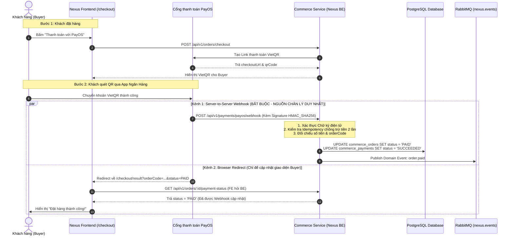
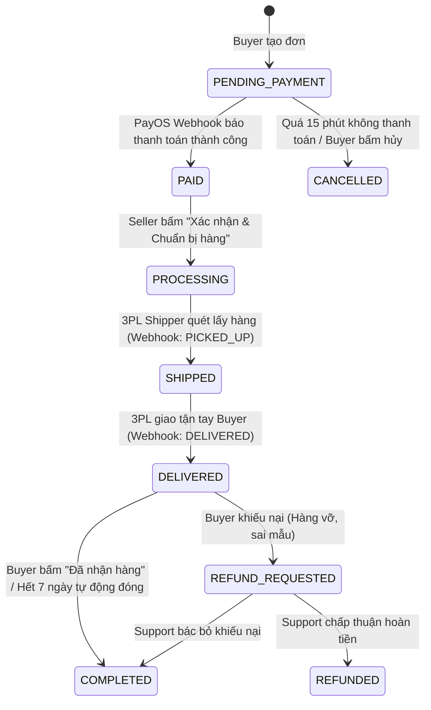
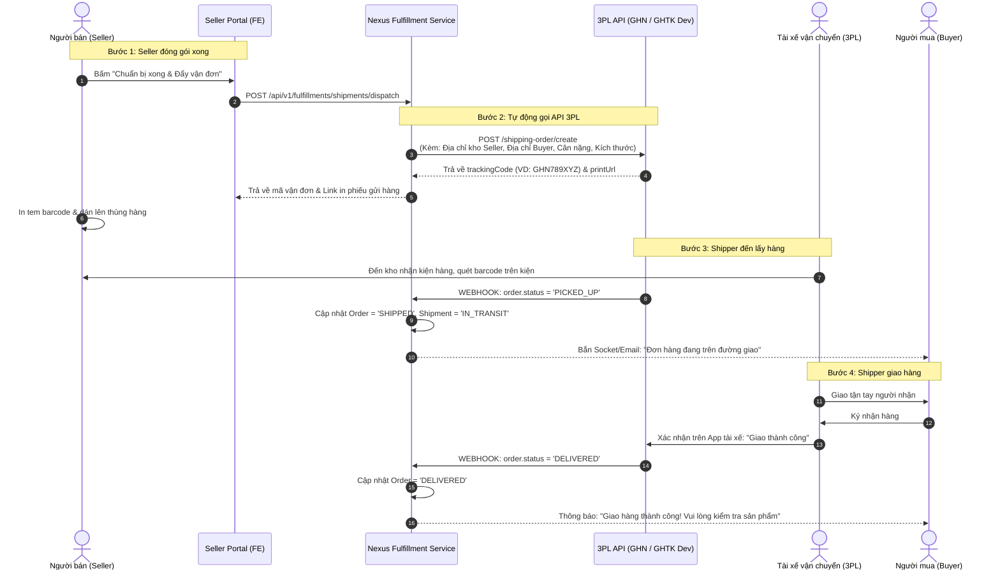
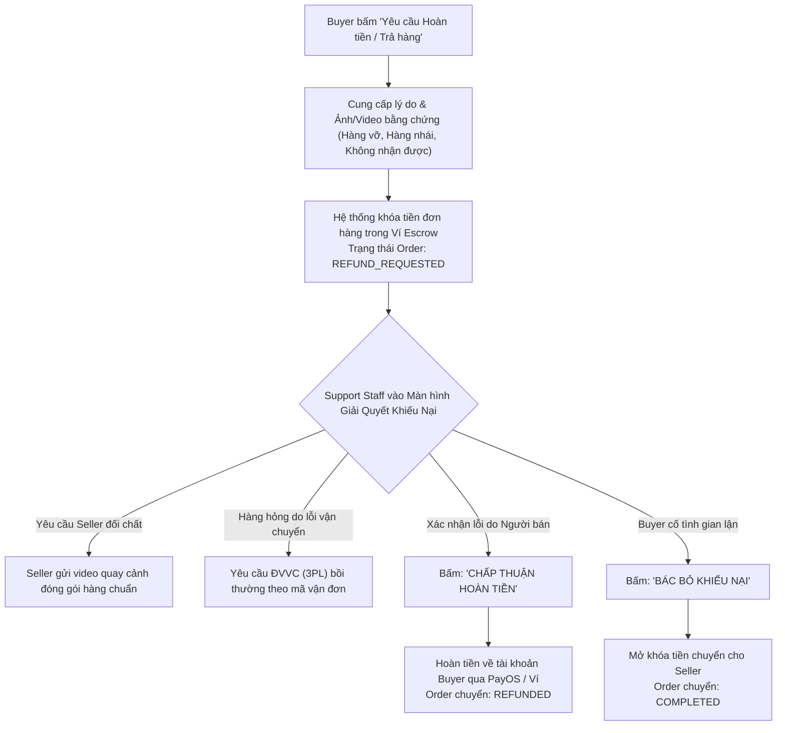

# Chiến Lược & Quy Trình Toàn Diện Sau Checkout (Post-Checkout & Fulfillment Strategy)

> **Tài liệu hướng dẫn nghiệp vụ & kiến trúc hệ thống dành cho toàn bộ Team Nexus (Frontend & Backend).**  
> **Phiên bản:** 1.0.0  
> **Ngày cập nhật:** Tháng 11/2026  
> **Cổng thanh toán:** PayOS (VietQR Chuẩn NAPAS 247)  
> **Tích hợp vận chuyển:** API Đối tác 3PL (GHN / GHTK Developer Sandbox)

---

## 1. Tổng Quan & Vấn Đề Cốt Lõi Cần Giải Quyết

### 1.1. Thực trạng hiện tại của dự án

1. Khách hàng (Buyer) bấm đặt hàng tại `/checkout`, hệ thống sinh mã đơn hàng, hiển thị mã QR PayOS và thông tin tài khoản chuyển khoản.
2. Khách quét mã chuyển tiền thành công, PayOS điều hướng trình duyệt quay lại trang kết quả `/checkout/result`.
3. **Khoảng trống nghiệp vụ lớn:**
   - Sau khi tiền đã vào tài khoản, hệ thống Nexus tự động làm gì tiếp theo?
   - Bên Bán (Seller) nhận thông tin ở đâu và thao tác như thế nào để đóng gói giao hàng?
   - Bên Hỗ Trợ (Support / CSKH) có phải click chuột chuyển trạng thái cho từng đơn hàng hay không? Nếu có hàng nghìn đơn mỗi ngày thì vận hành thế nào?
   - Khi tích hợp API Đơn vị vận chuyển (3PL: Giao Hàng Nhanh / Giao Hàng Tiết Kiệm), các bước trên sẽ thay đổi và tự động hóa ra sao?

### 1.2. Định vị 4 Role trong toàn bộ vòng đời đơn hàng

| Role                             | Trách nhiệm chính trong hệ sinh thái                                  | Hành động trên giao diện (UI Action)                                                                                                                                                                                                    | Mức độ tự động hóa                               |
| :------------------------------- | :-------------------------------------------------------------------- | :-------------------------------------------------------------------------------------------------------------------------------------------------------------------------------------------------------------------------------------- | :----------------------------------------------- |
| **Buyer (Người mua)**            | Khách hàng mua sắm, thanh toán, nhận hàng và đánh giá.                | - Quét VietQR PayOS để thanh toán.<br>- Xem tiến độ đơn hàng (Tracking timeline).<br>- Bấm "Đã nhận được hàng" (`Confirm Delivery`).<br>- Gửi yêu cầu Trả hàng / Hoàn tiền nếu sản phẩm lỗi.                                            | **Chủ động** theo nhu cầu mua sắm.               |
| **Seller (Người bán)**           | Quản lý kho, chuẩn bị hàng và giao kiện hàng cho shipper.             | - Nhận thông báo đơn mới đã thanh toán (`ORDER_PAID`).<br>- In phiếu đóng gói & mã vận đơn (Shipping Label).<br>- Đóng gói sản phẩm, bấm "Sẵn sàng giao cho ĐVVC".                                                                      | **Chủ động chuẩn bị hàng hóa vật lý**.           |
| **3PL Carrier (GHN/GHTK)**       | Đơn vị vận chuyển thứ ba nhận hàng từ kho Seller và chuyển đến Buyer. | - Cấp mã vận đơn (`trackingCode`) qua API.<br>- Shipper đến kho lấy hàng.<br>- Quét barcode cập nhật lộ trình (Đang trung chuyển, Đang giao, Đã giao, Giao thất bại).                                                                   | **Tự động 100% qua Webhook API**.                |
| **Support Staff (CSKH / Admin)** | Trọng tài giám sát vận hành sàn, giải quyết khiếu nại & tranh chấp.   | - **TUYỆT ĐỐI KHÔNG** click tay chuyển trạng thái đơn hàng thông thường!<br>- Tiếp nhận và xử lý vé khiếu nại (`Dispute / Refund Request`).<br>- Kiểm tra bằng chứng vi phạm, quyết định hoàn tiền cho Buyer hoặc giải ngân cho Seller. | **Chỉ can thiệp ngoại lệ (Exception Handling)**. |

> [!IMPORTANT]
> **LƯU Ý ĐẶC BIỆT DÀNH CHO TEAM FE & BE:**  
> Các nút bấm chuyển trạng thái đơn hàng thủ công trên màn hình Support hiện tại (ví dụ: nút bấm đổi sang "Đang giao", "Đã giao") **chỉ mang tính chất mô phỏng (Simulator / Dev Tools)** để team kiểm thử giao diện khi chưa đấu nối Webhook thật.  
> Trong môi trường chạy thật (Production), trạng thái vận chuyển **100% do hệ thống và Webhook của GHN/GHTK điều khiển tự động**. Không một nhân viên Support nào phải ngồi bấm tay cho hàng nghìn đơn hàng.

---

## 2. Kiến Trúc Kỹ Thuật: Luồng Dữ Liệu Sau Khi Thanh Toán PayOS

### 2.1. Hai kênh phản hồi PayOS: Browser Redirect vs Server Webhook

Khi khách hàng thanh toán xong mã VietQR PayOS, có 2 luồng phản hồi xảy ra song song:



### 2.2. Nguyên tắc bảo mật bất di bất dịch của PayOS

1. **Frontend không bao giờ được tin URL Query:** Kẻ gian hoàn toàn có thể tự gõ `localhost:3000/checkout/result?status=PAID` lên thanh địa chỉ trình duyệt. Do đó, trang `/checkout/result` của FE **luôn luôn phải gọi API `GET /api/v1/orders/:id/payment-status`** về Backend để đọc trạng thái xác thực thực tế từ Database.
2. **Backend xác minh chữ ký điện tử (Signature Verification):** Endpoint Webhook của Backend (`POST /api/v1/payments/payos/webhook`) bắt buộc phải kiểm tra chữ ký `checksum` bằng `PAYOS_CHECKSUM_KEY`. Mọi request không đúng chữ ký bị từ chối `400 Bad Request` ngay lập tức.
3. **Cơ chế Idempotency chống xử lý lặp:** PayOS có thể retry webhook nhiều lần nếu mạng chập chờn. Backend dùng `idempotency_key` (hoặc `transactionId`) trong bảng `commerce_payments` để đảm bảo nếu nhận cùng 1 webhook 10 lần thì chỉ cập nhật DB đúng 1 lần duy nhất.

---

## 3. Bản Đồ Trạng Thái Máy (State Machine Matrix) Giữa Đơn Hàng & Vận Đơn

Hệ thống Nexus phân chia rõ ràng giữa **Đơn hàng thương mại (Order)** thuộc `commerce-service` và **Đơn vận chuyển (Shipment)** thuộc `fulfillment-service`.



### 3.1. Bảng đối chiếu chi tiết giữa Order và Shipment

| Trạng thái Order (`commerce_orders`) | Trạng thái Shipment (`fulfillment_shipments`) | Tác nhân kích hoạt (Trigger By) | Mô tả chi tiết hành vi hệ thống                                                                                                                                                |
| :----------------------------------- | :-------------------------------------------- | :------------------------------ | :----------------------------------------------------------------------------------------------------------------------------------------------------------------------------- |
| `PENDING_PAYMENT`                    | _(Chưa tạo Shipment)_                         | **Buyer**                       | Đơn hàng vừa khởi tạo. Kho tạm giữ (`reservedQuantity`) trong 15-30 phút. Chờ tiền về qua PayOS.                                                                               |
| `PAID`                               | `PENDING` (Chờ điều phối)                     | **PayOS Webhook**               | Tiền đã vào tài khoản. Đơn hàng chuyển sang trạng thái đã thanh toán. Seller nhận thông báo có đơn mới.                                                                        |
| `PROCESSING`                         | `READY_TO_PICK` (Chờ lấy)                     | **Seller**                      | Seller bấm "Chuẩn bị xong hàng". Hệ thống tự động gọi API GHN/GHTK sinh mã vận đơn (`trackingCode`). Seller in phiếu dán lên gói hàng.                                         |
| `SHIPPED`                            | `IN_TRANSIT` (Đang giao)                      | **3PL Shipper (GHN/GHTK)**      | Shipper đến kho Seller nhận hàng và quét mã barcode. API Webhook của GHN/GHTK bắn sang Nexus báo tài xế đã lấy hàng đi giao.                                                   |
| `DELIVERED`                          | `DELIVERED` (Giao thành công)                 | **3PL Shipper (GHN/GHTK)**      | Shipper giao thành công cho Buyer và cập nhật trên app tài xế. 3PL Webhook bắn sang Nexus báo giao thành công.                                                                 |
| `COMPLETED`                          | `DELIVERED`                                   | **Buyer hoặc Hệ thống**         | Buyer bấm nút "Đã nhận được hàng" trên web, HOẶC sau 7 ngày kể từ lúc DELIVERED mà Buyer không có khiếu nại gì thì hệ thống tự động hoàn tất đơn và giải ngân tiền cho Seller. |
| `CANCELLED`                          | `CANCELLED`                                   | **Hệ thống hoặc Seller**        | Đơn bị hủy do quá hạn thanh toán hoặc Seller báo hết hàng vật lý. Kho tự động nhả tồn giữ chỗ (`RELEASE`).                                                                     |
| `REFUND_REQUESTED`                   | `DELIVERED` / `RETURNING`                     | **Buyer**                       | Buyer bấm "Yêu cầu Trả hàng / Hoàn tiền" vì hàng hỏng vỡ, sai mô tả. Tiền đơn hàng bị tạm đóng băng (Escrow).                                                                  |
| `REFUNDED`                           | `RETURNED`                                    | **Support Staff**               | Support duyệt khiếu nại, tiền được hoàn lại cho Buyer qua cổng thanh toán/số dư tài khoản.                                                                                     |

---

## 4. Tích Hợp API Đơn Vị Vận Chuyển 3PL (GHN / GHTK Sandbox)

Khi team tích hợp **API dành riêng cho Developer của GHN hoặc GHTK**, 4 bước vận hành sẽ được **tự động hóa khép kín** như sau:



### 4.1. Contract API gửi sang 3PL (Ví dụ chuẩn GHN)

```json
{
  "payment_type_id": 1,
  "note": "Cho khách xem hàng trước khi nhận",
  "required_note": "KHONGCHOXEMHANG",
  "from_name": "Kho Tổng Nexus - Shop ABC",
  "from_phone": "0912345678",
  "from_address": "Tầng 5, Tòa nhà Nexus, Quận 1",
  "to_name": "Trần Chí Thiện",
  "to_phone": "0963433671",
  "to_address": "123 Đường Nguyễn Trãi",
  "to_ward_code": "20311",
  "to_district_id": 1444,
  "weight": 500,
  "length": 20,
  "width": 15,
  "height": 10,
  "service_type_id": 2
}
```

### 4.2. Endpoint Webhook mà Backend Nexus cần lắng nghe từ 3PL

- **URL Route đề xuất:** `POST /api/v1/fulfillment/carriers/webhook`
- **Payload 3PL gửi về khi có biến động lộ trình:**

```json
{
  "carrier": "GHN",
  "tracking_code": "GHN789XYZ",
  "status": "DELIVERED",
  "current_location": "Bưu cục Quận Bình Thạnh, TP.HCM",
  "shipper_name": "Nguyễn Văn Tài",
  "shipper_phone": "0987654321",
  "timestamp": "2026-11-03T15:30:00Z"
}
```

Khi nhận được webhook này, Backend đối chiếu `tracking_code` trong bảng `fulfillment_shipments` và tự động cập nhật:

1. `Shipment.status = DELIVERED`
2. `Order.status = DELIVERED`
3. Gửi Socket.io / Push notification thông báo cho cả Buyer và Seller theo thời gian thực!

---

## 5. Vai Trò Đúng Đắn Của Support Staff: Xử Lý Khiếu Nại & Tranh Chấp (Dispute)

Như đã khẳng định, **Support Staff không quản lý các đơn hàng chạy bình thường**. Nhiệm vụ chính của Support trên sàn là **Trọng tài giải quyết sự cố (Escalation & Dispute Resolution)**:



### Quy định thiết kế UI Support:

- Giao diện Support hiện tại nên phân nhóm thành 2 tab:
  1. **Tab 1: Tra cứu & Giám sát (Monitoring / Audit Log):** Chỉ cho phép xem chi tiết hành trình, lịch sử biến động, xem mã vận đơn. Không có nút can thiệp trạng thái đơn hàng thông thường.
  2. **Tab 2: Khiếu nại & Tranh chấp (Disputes & Tickets):** Nơi hiển thị các đơn đang có cờ `REFUND_REQUESTED`. Nhân viên Support xem bằng chứng của 2 bên và có 2 nút hành động: **[Chấp thuận Hoàn Tiền]** hoặc **[Bác Bỏ Khiếu Nại]**.

---

## 6. Kế Hoạch Phân Công Công Việc Giữa Backend & Frontend

### 6.1. Backend Engineers (BE Roadmap)

|   STT    | Bounded Context        | Tên tác vụ kỹ thuật                                                                                            | Đầu ra nghiệm thu                                                                             |
| :------: | :--------------------- | :------------------------------------------------------------------------------------------------------------- | :-------------------------------------------------------------------------------------------- |
| **BE-1** | `commerce-service`     | Viết endpoint nhận Webhook PayOS chuẩn: `POST /api/v1/payments/payos/webhook`.                                 | Kiểm tra đúng chữ ký checksum HMAC_SHA256, cập nhật `Order = PAID`, xử lý Idempotent.         |
| **BE-2** | `commerce-service`     | Phát sự kiện Domain Event `order.paid` lên RabbitMQ (kèm mã `orderId`, `buyerId`, `items`, `shippingAddress`). | Consumer ở các service khác nhận được message.                                                |
| **BE-3** | `fulfillment-service`  | Lắng nghe event `order.paid`, tự động tạo bản ghi trong bảng `fulfillment_shipments` với trạng thái `PENDING`. | Bản ghi shipment được liên kết chính xác với `orderId`.                                       |
| **BE-4** | `fulfillment-service`  | Xây dựng Module Adapter tích hợp API 3PL Sandbox (GHN hoặc GHTK Developer API).                                | Khi gọi endpoint Dispatch, BE kết nối sang 3PL lấy được `trackingCode` thật về lưu DB.        |
| **BE-5** | `fulfillment-service`  | Viết endpoint nhận Webhook từ 3PL: `POST /api/v1/fulfillment/carriers/webhook`.                                | Cập nhật tự động trạng thái `IN_TRANSIT` và `DELIVERED` vào Database mà không cần ai bấm tay. |
| **BE-6** | `notification-service` | Lắng nghe các domain event vận chuyển để gửi Email thông báo và Socket realtime cho Buyer & Seller.            | Email báo đơn mới cho Seller, Email báo mã tracking cho Buyer.                                |

### 6.2. Frontend Engineers (FE Roadmap)

|   STT    | Phân hệ UI     | Tên tác vụ giao diện                                                                                                                                                                               | Đầu ra nghiệm thu                                                |
| :------: | :------------- | :------------------------------------------------------------------------------------------------------------------------------------------------------------------------------------------------- | :--------------------------------------------------------------- |
| **FE-1** | Buyer Portal   | Trang `/checkout/result`: Gọi API `GET /api/v1/orders/:id/payment-status` để hiển thị kết quả thực từ DB (thay vì đọc URL param).                                                                  | Không còn bị bypass bằng cách chỉnh sửa tham số URL query.       |
| **FE-2** | Buyer Portal   | Trang Chi tiết đơn hàng `/account/orders/[id]`: Hiển thị thanh tiến trình vận chuyển trực quan (Timeline 4 bước: Đã đặt -> Đã thanh toán -> Đang giao -> Đã nhận). Kèm mã vận đơn và tên hãng 3PL. | Buyer biết chính xác kiện hàng đang ở đâu.                       |
| **FE-3** | Seller Portal  | Trang Quản lý đơn hàng `/seller/orders`: Hiển thị tab "Chờ đóng gói" (các đơn đã `PAID`). Cung cấp nút **"In Phiếu Gửi Hàng"** và nút **"Sẵn Sàng Giao Cho ĐVVC"**.                                | Seller thao tác thuận tiện, không phải mò mẫm.                   |
| **FE-4** | Support Portal | Cải tạo màn hình Support: Đưa các nút bấm chuyển trạng thái vào thanh **"Developer / Demo Simulation Tools"** (ghi rõ chỉ dùng để test nội bộ).                                                    | Không gây hiểu nhầm rằng vận hành thực tế phải bấm tay từng đơn. |
| **FE-5** | Support Portal | Xây dựng màn hình "Xử lý khiếu nại" (Ticket Dispute): Xem thông tin hai bên, xem ảnh chụp hư hại của sản phẩm, có 2 nút quyết định Hoàn tiền / Bác bỏ.                                             | Đúng chuẩn nghiệp vụ chăm sóc khách hàng của sàn TMĐT.           |

---

## 7. Tổng Kết

- **Tính tự động hóa là linh hồn của E-Commerce:** Không một hệ sinh thái thương mại điện tử nào để nhân viên ngồi click tay trạng thái cho từng đơn hàng.
- **PayOS** chịu trách nhiệm hoàn tất dòng tiền và kích hoạt trạng thái `PAID` qua **Server Webhook**.
- **Seller** chịu trách nhiệm chuẩn bị hàng vật lý và bấm bàn giao cho đơn vị vận chuyển.
- **3PL (GHN/GHTK Developer API)** chịu trách nhiệm toàn bộ tiến trình giao nhận và tự động cập nhật trạng thái đơn hàng trên sàn qua **Carrier Webhook**.
- **Support Staff** đóng vai trò trọng tài tối cao giải quyết tranh chấp khiếu nại và bảo vệ quyền lợi người dùng.
