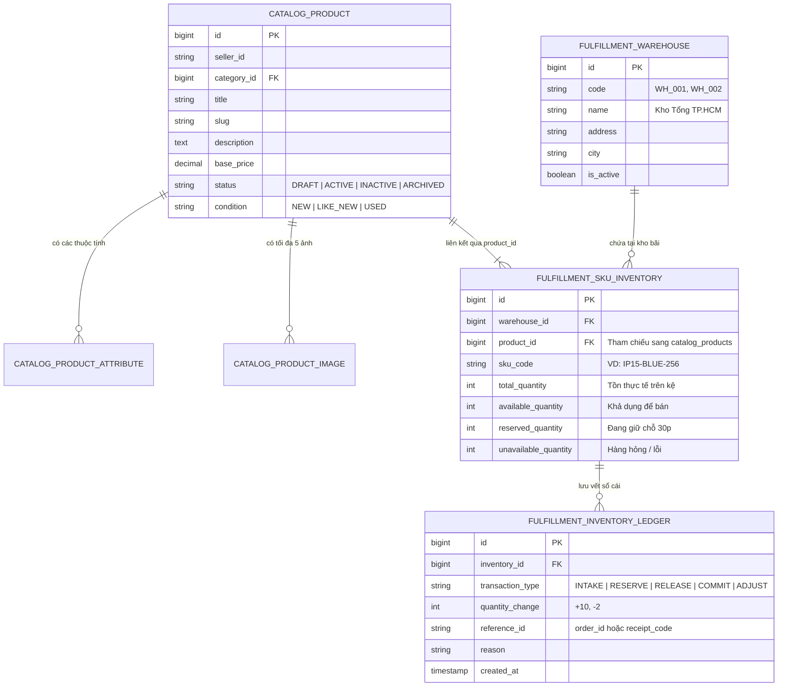
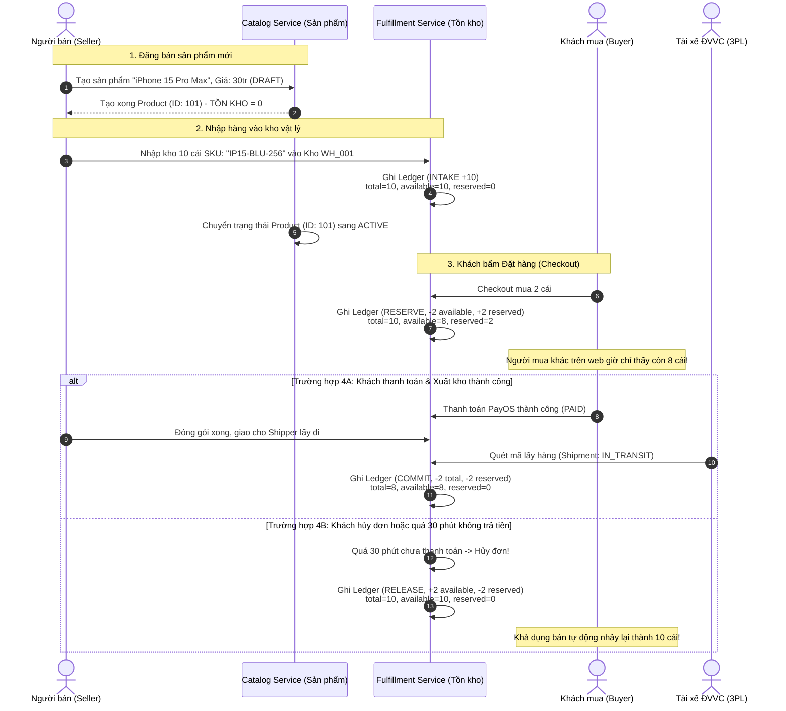

# Quan Hệ Giữa Danh Mục Sản Phẩm (Catalog) & Quản Trị Tồn Kho (Inventory) Trong Phân Hệ Seller

> **Tài liệu chuẩn hóa kiến trúc nghiệp vụ dành cho toàn bộ Team Nexus (Frontend & Backend).**  
> **Phiên bản:** 1.0.0  
> **Ngày cập nhật:** Tháng 11/2026  
> **Dịch vụ liên quan:** `catalog-service` (Port 5433) & `fulfillment-service` (Port 5436)

---

## 1. Vấn Đề Thực Tế: Vì Sao Không Gộp "Tồn Kho" Vào Chung "Sản Phẩm"?

### 1.1. Lối mòn tư duy thường gặp

Khi mới tiếp cận lập trình web bán hàng đơn giản, các lập trình viên thường tạo một bảng cơ sở dữ liệu duy nhất:

```sql
-- Cách làm cũ của ứng dụng nhỏ (NGUY HIỂM KHI LÊN SÀN TMĐT)
CREATE TABLE products (
    id SERIAL PRIMARY KEY,
    title VARCHAR(255),
    price DECIMAL,
    stock INT -- << Gộp số lượng tồn kho vào đây
);
```

### 1.2. Vì sao cách làm trên sụp đổ hoàn toàn trên Sàn Thương Mại Điện Tử thật?

Trên các sàn TMĐT chuyên nghiệp như Shopee, Lazada, Amazon và đồ án **Nexus**, cách làm gộp này sẽ gây ra 4 thảm họa kỹ thuật và nghiệp vụ:

1. **Một sản phẩm có nhiều biến thể (Phân loại hàng / SKU):**
   - Ví dụ sản phẩm: `Áo Thun Nexus Cotton 100%`.
   - Sản phẩm này có: 3 Màu (Đen, Trắng, Xanh) và 3 Kích cỡ (S, M, L) $\rightarrow$ Tổng cộng có **9 biến thể (SKU)** khác nhau.
   - Khách mua là mua chiếc "Áo Đen - Size M", chứ không thể mua chung chung "Áo Thun". Tồn kho phải quản lý chính xác cho từng biến thể một.
2. **Một sản phẩm nằm ở nhiều vị trí kho bãi vật lý:**
   - Người bán (Seller) hoặc Sàn có thể có: **Kho Hà Nội (WH_001)** và **Kho TP.HCM (WH_002)**.
   - Cùng một chiếc điện thoại iPhone 15, nhưng ở Kho Hà Nội còn 10 cái, còn Kho TP.HCM chỉ còn 2 cái. Nếu gộp vào bảng Product thì không biết đơn hàng của khách ở Sài Gòn nên xuất từ kho nào.
3. **Hiện tượng "Bán khống / Bán vượt tồn" (Overselling / Race Condition):**
   - Nếu 100 người cùng bấm mua 1 chiếc điện thoại còn lại cuối cùng trong cùng 1 giây, nếu chỉ có 1 trường `stock`, hệ thống sẽ bị xung đột ghi đè (Race Condition), dẫn đến bán quá số lượng thực tế, gây khiếu nại và hủy đơn hàng loạt.
4. **Vi phạm nguyên tắc Bounded Context (Domain-Driven Design - DDD):**
   - **Catalog Service (Mặt tiền thương mại):** Phục vụ Tiếp thị (Marketing), tìm kiếm sản phẩm, hiển thị ảnh đẹp, viết bài mô tả hấp dẫn, chấm điểm đánh giá sao, danh mục sản phẩm. Tần suất đọc (`READ`) cực lớn (hàng triệu lượt xem/giây).
   - **Fulfillment Service (Kho vận vật lý):** Phục vụ Kiểm kê hàng trên giá kệ, đóng gói, bảo quản, ghi sổ cái tài chính, giao hàng cho shipper. Đòi hỏi tính nhất quán giao dịch (`ACID`, Khóa hàng nghiêm ngặt) tuyệt đối.

---

## 2. Kiến Trúc Dữ Liệu & Mối Quan Hệ Giữa Hai Bounded Contexts



### Bảng so sánh trách nhiệm giữa Trang Sản Phẩm và Trang Tồn Kho

| Tiêu chí                      | Mục "Sản phẩm" (Catalog Service)                                                                     | Mục "Tồn kho" (Fulfillment Service)                                                                                           |
| :---------------------------- | :--------------------------------------------------------------------------------------------------- | :---------------------------------------------------------------------------------------------------------------------------- |
| **Góc nhìn nghiệp vụ**        | **Thương mại & Trưng bày (Showroom)**                                                                | **Vật lý & Vận hành kho (Warehouse)**                                                                                         |
| **Đơn vị quản lý**            | Theo Sản phẩm cha (`Product ID` / Mã bài đăng)                                                       | Theo Đơn vị phân loại kho chi tiết (`SKU Code` + `Warehouse ID`)                                                              |
| **Thông tin trọng tâm**       | Tên sản phẩm, Bộ sưu tập ảnh (tối đa 5 ảnh), Mô tả chi tiết, Danh mục cha con, Giá niêm yết ban đầu. | Số lượng thùng/hộp thực tế trên giá kệ, Số lượng đang khóa giữ chỗ, Số lượng hàng bị vỡ nứt, Sổ cái lịch sử nhập xuất.        |
| **Thao tác của Seller**       | Đăng bán bài mới, Đổi tiêu đề, Thay ảnh đại diện, Hạ bài đăng (`INACTIVE`), Bật/Tắt chế độ đấu giá.  | Lập phiếu nhập kho (Stock In), Kiểm kê hàng tháng (Stock Audit / Adjust), Điều chuyển hàng giữa các kho, Theo dõi thất thoát. |
| **Khi nào dữ liệu thay đổi?** | Khi Seller chủ động chỉnh sửa nội dung bài đăng.                                                     | Tự động biến động **theo từng giây** khi có khách bấm checkout, khi khách hủy đơn, hoặc khi shipper đến bốc hàng.             |

---

## 3. Bộ 3 Chỉ Số Tồn Kho Vàng (The Golden Stock Metrics)

Trong cơ sở dữ liệu `fulfillment_sku_inventories`, mỗi SKU được kiểm soát bằng 4 con số độc lập:

```
[ Tổng tồn thực tế: totalQuantity ]
         │
         ├── Khả dụng bán được: availableQuantity
         ├── Đang giữ chỗ tạm:  reservedQuantity (Phiên checkout / Đóng gói)
         └── Hàng lỗi / Hỏng:   unavailableQuantity (Chờ thanh lý)
```

### 3.1. Ý nghĩa cụ thể của từng chỉ số:

1. **`totalQuantity` (Tồn kho thực tế / On-Hand):**
   - Là số lượng hàng hóa **thực sự đang nằm trên kệ** trong kho bãi vật lý.
   - Chỉ tăng khi: Lập phiếu nhập kho mới (`INTAKE`).
   - Chỉ giảm khi: Kiện hàng thực sự được shipper lấy đi giao (`COMMIT`) hoặc đem đi tiêu hủy vì hư hỏng.
2. **`reservedQuantity` (Đang giữ chỗ / Tạm khóa):**
   - Là số lượng hàng hóa đang được khóa tạm cho các phiên giao dịch:
     - Khách hàng vừa bấm Đặt hàng nhưng chưa thanh toán (SRS: khóa tối đa 30 phút).
     - Khách hàng đã thanh toán thành công, đơn hàng đang ở trạng thái chuẩn bị đóng gói.
   - Hàng này **vẫn còn trong kho vật lý**, nhưng **không được phép bán cho người khác nữa**.
3. **`unavailableQuantity` (Hàng lỗi / Hỏng hóc):**
   - Là số lượng hàng bị móp méo, vỡ màn hình, rách bao bì, quá hạn sử dụng phát hiện trong quá trình lưu kho. Hàng này nằm trong kho nhưng bị cách ly, tuyệt đối không được xuất bán.
4. **`availableQuantity` (Khả dụng để bán):**
   - Là số lượng hiển thị trên website Nexus cho khách hàng nhìn thấy để bấm "Thêm vào giỏ" hoặc "Mua ngay".

### 3.2. Công thức tính toán chuẩn mực

$$\mathbf{availableQuantity} = \mathbf{totalQuantity} - \mathbf{reservedQuantity} - \mathbf{unavailableQuantity}$$

> [!CAUTION]
> **Quy tắc vàng cho Backend:**  
> Hệ thống **tuyệt đối không bao giờ cho phép** `availableQuantity < 0`. Nếu khách đặt hàng mà số lượng yêu cầu vượt quá `availableQuantity`, API Checkout phải trả về lỗi `409 Conflict: Hàng trong kho không đủ`.

---

## 4. Vòng Đời Hoạt Động Chi Tiết (End-to-End Operational Lifecycle)

Dưới đây là kịch bản trực quan giải thích sự phối hợp nhịp nhàng giữa Sản Phẩm và Tồn Kho từ khi mở bán đến khi giao tận tay khách:



---

## 5. Nguyên Tắc Sổ Cái Biến Động Kho (Append-Only Inventory Ledger)

Theo yêu cầu nghiêm ngặt của tài liệu đặc tả kiến trúc Nexus (SRS 3.6.1):  
**Bảng `fulfillment_inventory_ledgers` là bảng BẤT BIẾN (APPEND-ONLY). Tuyệt đối KHÔNG có câu lệnh `UPDATE` hay `DELETE` nào được phép chạy trên bảng này.**

### 5.1. Ví dụ thực tế một chuỗi giao dịch trong sổ cái:

|  ID   | Inventory ID | Loại giao dịch (`transaction_type`) | Biến động (`quantity_change`) | Mã tham chiếu (`reference_id`) | Diễn giải lý do (`reason`)          | Thời điểm ghi nhận |
| :---: | :----------: | :---------------------------------: | :---------------------------: | :----------------------------: | :---------------------------------- | :----------------- |
| **1** |   SKU-001    |              `INTAKE`               |             `+50`             |         `NK-20261101`          | Nhập lô hàng mới từ Apple VN        | 01/11/2026 08:00   |
| **2** |   SKU-001    |              `RESERVE`              |             `-1`              |       `ORD-20261102-001`       | Khách Nguyễn Văn A đặt hàng PayOS   | 02/11/2026 09:15   |
| **3** |   SKU-001    |              `COMMIT`               |             `-1`              |       `ORD-20261102-001`       | Shipper GHN đã đến lấy hàng đi giao | 02/11/2026 14:00   |
| **4** |   SKU-001    |              `RESERVE`              |             `-2`              |       `ORD-20261102-088`       | Khách Trần Thị B đặt 2 cái          | 02/11/2026 15:00   |
| **5** |   SKU-001    |              `RELEASE`              |             `+2`              |       `ORD-20261102-088`       | Khách hủy đơn vì đổi ý, nhả tồn     | 02/11/2026 15:20   |
| **6** |   SKU-001    |              `ADJUST`               |             `-1`              |         `KK-20261103`          | Rơi vỡ trong lúc dọn kho kệ B2      | 03/11/2026 10:00   |

### 5.2. Giá trị cốt lõi của sổ cái:

- **Chống thất thoát nội bộ:** Mọi chiếc ốc vít hay điện thoại bị thiếu hụt đều có dòng log ghi rõ do ai, vào giờ nào, gắn liền với đơn hàng nào.
- **Kiểm toán tài chính độc lập:** Cuối tháng, Kế toán chỉ cần lấy `SUM(quantity_change)` của các dòng `INTAKE` trừ đi `COMMIT` và `ADJUST` là phải khớp 100% với số lượng kiểm đếm thực tế dưới kho.

---

## 6. Hướng Dẫn Thiết Kế & Trải Nghiệm Người Dùng Trên Frontend (FE UI Guide)

Để Người bán (Seller) không bị hoang mang giữa 2 trang này, Frontend cần hiển thị giao diện theo đúng phân cấp vai trò:

### 6.1. Trang 1: Quản lý Sản phẩm (`/seller/products`)

- **Mục đích:** Quản lý bài đăng bán hàng.
- **Dữ liệu hiển thị:**
  - Ảnh đại diện sản phẩm + Tên sản phẩm + Danh mục (VD: Đồ điện tử).
  - Giá bán niêm yết (VND).
  - Badge trạng thái bài đăng: `Đang bán (ACTIVE)`, `Bản nháp (DRAFT)`, `Tạm ẩn (INACTIVE)`.
  - Cột "Tổng tồn khả dụng": Là **con số tổng hợp (Read-only)** được cộng dồn từ tất cả các SKU của sản phẩm đó.
  - Các nút thao tác: `[+ Thêm sản phẩm mới]`, `[Chỉnh sửa bài viết]`, `[Tạm ẩn sản phẩm]`, `[Xem trong kho]`.

### 6.2. Trang 2: Quản trị Tồn kho & Kho vận (`/seller/inventory`)

- **Mục đích:** Quản lý số lượng hàng hóa và lịch sử nhập xuất.
- **Dữ liệu hiển thị:** Bảng chi tiết từng dòng SKU:
  - Mã SKU (VD: `IP15-BLU-128`, `IP15-TITAN-256`).
  - Tên sản phẩm gốc tương ứng.
  - Kho lưu trữ (VD: `Kho Tổng TP.HCM (WH_001)`).
  - **Cột 1: Tồn thực tế (On-hand)** $\rightarrow$ Số lượng thật trên kệ.
  - **Cột 2: Đang giữ chỗ (Reserved)** $\rightarrow$ Đơn hàng đang chờ thanh toán / chuẩn bị gửi.
  - **Cột 3: Khả dụng (Available)** $\rightarrow$ Số lượng mở bán (Có màu xanh lá nếu còn hàng, màu đỏ nếu sắp hết hàng).
  - **Cột 4: Hàng lỗi (Unavailable)** $\rightarrow$ Hàng chờ thanh lý.
- **Các nút hành động trên trang Tồn kho:**
  - `[+ Nhập kho (Stock In)]`: Mở Modal cho Seller nhập thêm số lượng và ghi chú phiếu nhập.
  - `[Điều chỉnh kiểm kê (Adjust Stock)]`: Cho phép khai báo hàng hư hại / hao hụt kèm lý do.
  - `[Xem nhật ký sổ cái (View Ledger)]`: Mở Drawer xem toàn bộ lịch sử biến động từng giây của SKU đó.

---

## 7. Bảng Tóm Tắt Ghi Nhớ Cho Team (Cheat Sheet)

```
┌────────────────────────────────────────────────────────────────────────┐
│                          DỰ ÁN NEXUS E-COMMERCE                        │
├──────────────────────────────────┬─────────────────────────────────────┤
│   MỤC SẢN PHẨM (CATALOG)         │     MỤC TỒN KHO (INVENTORY)         │
├──────────────────────────────────┼─────────────────────────────────────┤
│ 1. Trả lời câu hỏi: BÁN CÁI GÌ?  │ 1. Trả lời: CÒN BAO NHIÊU CÁI Ở ĐÂU?│
│ 2. Đơn vị: Product (Tên, Ảnh)    │ 2. Đơn vị: SKU Code + Warehouse ID  │
│ 3. Khách mua nhìn thấy để chọn   │ 3. Thủ kho và Shipper dùng để soạn  │
│ 4. Không đổi khi khách đặt mua   │ 4. Biến động liên tục theo từng đơn │
│ 5. DRAFT / ACTIVE / INACTIVE     │ 5. ON-HAND = AVAILABLE + RESERVED   │
└──────────────────────────────────┴─────────────────────────────────────┘
```
